# Architecture

How the package is put together: what it stores, how a check, a change and a list each run, how
groups, labels and policies combine, and how history is kept. The [README](../README.md) is the
guide to using it; this is the map of how it works, for reviewers and contributors. Each diagram
names the functions and tables it shows, so it can be checked against the code.

- [Context](#context)
- [Inside the package](#inside-the-package)
- [Data model](#data-model)
- [Principals, groups and keys](#principals-groups-and-keys)
- [Resources, scopes and paths](#resources-scopes-and-paths)
- [A check](#a-check)
- [A change](#a-change)
- [Lists and searches](#lists-and-searches)
- [Labels and exclusive values](#labels-and-exclusive-values)
- [Transactions and locks](#transactions-and-locks)
- [History, export and AsOf](#history-export-and-asof)
- [Database roles](#database-roles)
- [Bounds](#bounds)

## Context

The package is a Go library that a host application links. It keeps everything in PostgreSQL, in
tables prefixed `rbac_` in one schema, and asks the host only through the hooks in `Config` and
the `crypto.Signer` an export is given. It runs no server and holds no state between calls but
compiled conditions.

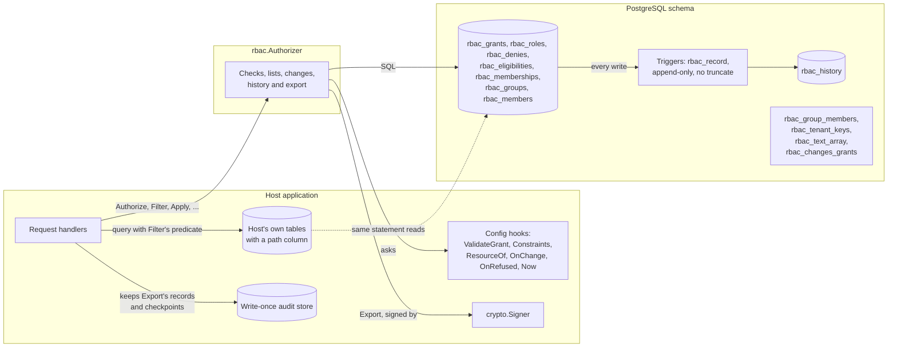

- **One database, one transaction.** A change runs in a transaction of its own, or under
  `WithTx` in a savepoint of the host's, so the host can create a resource and its creator's grant
  together.
- **The host owns identity and resources.** It says who a subject is (`Subject`) and what a
  resource is, with its ancestors and attributes (`Resource`). The package stores only grants,
  eligibilities, roles, denies, memberships and groups, and their history, keyed by the ids the
  host gives.
- **The host decides who may hold what.** `ValidateGrant` is asked about every grant and
  eligibility a change makes, and every place in a group, which gives what the group holds.
  `Constraints` remove permissions above anything a tenant grants. The host's own writes,
  `Import`, `ImportGroups`, `ImportMembers`, `SetMemberships` and the host's deletes, skip the
  checks made of an actor, but `Import` and `ImportMembers` still ask `ValidateGrant` about what
  they give.

## Inside the package

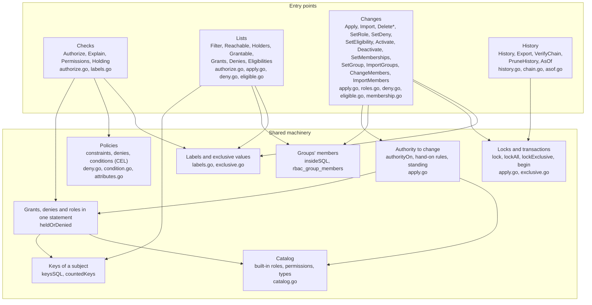

## Data model

Every row is a tenant's, by its `tenant` column: nothing is shared between tenants, and a tenant
is deleted with `DeleteTenant`. A scope is `type:id`, as `scope_type` and `scope_id`, with the
generated column `scope`. A principal is `kind:id`, as `principal_kind` and `principal_id`, with
the generated column `principal`.

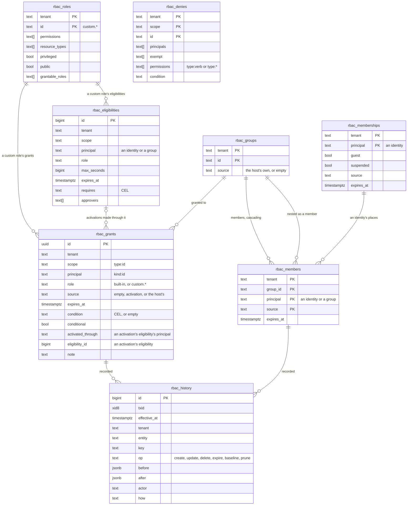

- **Built-in roles are not stored.** They are the host's `Config.Catalog`, so a deploy changes
  them for every tenant at once. Custom roles are a tenant's own, prefixed `custom.`, and give
  only permissions and types the catalog has.
- **A grant is one role to one principal on one scope**, from one source, until one time, under
  one condition. The key index `rbac_grants_key` holds what a check reads, so a check's read of
  grants is an index-only scan. The indexes by scope and by principal lead to both too and hold the
  same, so a connection's cached statement, once PostgreSQL plans it generically by the tables'
  averages, still reads only the subject's grants on the path, from the index alone, whichever
  index it picks. A search decides which custom roles the public's and the tenant's members' grants
  name before its statement, from `rbac_grants_custom_principal`, which holds only grants of custom
  roles, by principal and scope, and reads only those its subject counts: the anonymous and a guest
  read none of the members', and a search of a permission no public role gives none of the
  public's, so their grants of built-in roles on thousands of resources cost it nothing.
- **A read of a list of keys reads each key's rows on its own** (`byKey`), as of a list's scopes
  or principals, of the denies on a check's path, of `Activate`'s eligibilities and of the rows
  `DeleteScopes`, `DeletePrincipal` and `DeleteGroups` remove, and so does a walk through nested
  groups: a generic plan costs `= ANY` of a list as ten seeks, and a read of the tenant by an index
  on it alone as an average tenant's few rows, and would read every row of a large tenant. The rows
  a removal locks in order it then deletes by key, never matched to the tenant's in a semi-join,
  which such a plan runs by reading every one. The eligibilities a group approves and the
  denies that name or exempt it, which a change to its members and `DeleteGroup`'s check read,
  those an identity or group leaving the tenant is taken out of, and the denies naming a list's
  subject or its groups, which `Filter` and `Reachable` read, are found through GIN indexes on
  those arrays of keys, each key prefixed by its tenant (`rbac_tenant_keys`), so neither the
  tenant's other rows nor another tenant's group of the same id are read. The denies binding the
  actor of a change to members or of `DeleteGroup` that remove a power to change grants, whose types
  they read wherever in the tenant the denies are (`grantsDenied`), are found through such an index
  holding only those (`rbac_denies_grants`, by `rbac_changes_grants`), so the other denies naming
  the tenant's members or the public, which bind every actor, aren't read. History indexes the keys
  each version of a deny names so too, so as of a time those lists find them the same way, and
  they count the denies on their types by history's versions of them, at most a few: through the
  views, which read every version of a deny to find its last, counting read every one, deleted
  denies' too.
- **Activations are grants** from the source `activation` (`SourceActivation`), made by
  `Activate` from an eligibility, which they record, and ended by their expiry, `Deactivate`, or a
  change ending the membership or a place in a group on their holder's paths to that eligibility's
  principal sooner.
- **Every write is recorded.** Each table above but `rbac_history` has the trigger
  `rbac_record`, which writes the change into `rbac_history`. Nothing updates or truncates that
  table, and only `PruneHistory`, as a role with the rights of its owner, deletes from it, each
  delete reached by a prune its transaction records. Each
  record reads its key's last by history's index of each entity's keys, in a generic plan with
  sequential scans off: a plan its session made while history was small would otherwise scan all
  of it for each row, and one made for each row, until history is analyzed, read all of the
  tenant's records of the entity, so a statement writing many would take time growing with the
  square of their number.

## Principals, groups and keys

A check counts what the subject's principals hold. They are found in the same statement as the
grants (`keysSQL`), up from the identity: its membership of the tenant, the groups it is in, and
the groups those are in, each counted once, as deep as they nest, which changes keep to
`MaxGroupDepth`.

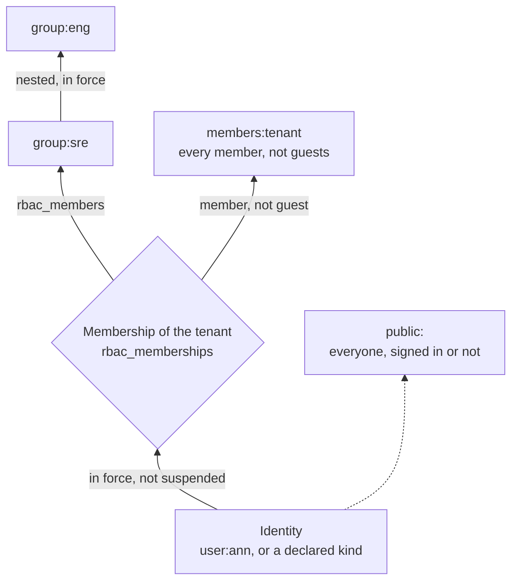

| Key | Counts for | Notes |
|---|---|---|
| `user:ann` | Its own grants | Only while it is a member or guest of the tenant, not suspended. |
| `group:sre` and the groups above it | The group's grants | Through each place in force, while the identity's membership is not suspended. |
| `members:<tenant>` | Grants to every member | Not to guests. Never a privileged role, nor one that changes access. |
| `public:` | Grants to everyone | Only roles marked `Public`, never a privileged one nor one that changes access. The anonymous subject holds these alone. |

- **Denies bind more widely than grants give.** A deny binds an identity through its groups and
  the tenant's members even while its membership is suspended, so suspending someone never lifts
  a deny (`bound`). A deny's exemptions are matched against every key the subject is in, the
  tenant's members too where a check of a permission that changes access counts none of their
  grants, and the identity's own (`exempted`).
- **Changing a group's members is granting.** Adding an identity to a group gives it what the group
  holds, so `ChangeMembers` needs the authority to grant all of it, and the host's `ValidateGrant`
  is asked as for a grant. The same holds for nesting one group in another, and a change that adds a
  member and nests its group asks about the member against every group it will be in. What a change
  reaches is read once (`reach`, indexed by the keys it names), however many members of a group
  change and however many of the groups are in one that reaches it, and its grants are decided once
  for each role, condition and end on a scope, as the member a grant names decides nothing of the
  actor's power to make it; only the host is asked about each member's, which `MaxBindings` bounds
  for `ChangeMembers` but for what one place alone gains. A member is its principal: what all the
  groups, and places in one, a change gives it reach is counted, and asked about, once for each end
  its places give it (`gainsWithin`, `askMemberships`), so a group two of them are in counts once,
  as does a group it is placed in from two sources until one end; past `MaxBindings`, a change
  gains no more than its largest place alone does, so joining several groups never multiplies what
  one change asks, nor what it builds: the grants it checks and the footprint `stillReached`
  compares are found from what each principal gains (`gained`), and from the groups holding it,
  not from each group that reaches them. `ImportMembers`, the host's own write, which no actor's access decides, asks it
  once for each member and each grant or eligibility the member gains, with no bound on them, so
  its cost grows with that.
- **Expanding down** from groups to their identities, for lists and changes, is `insideSQL`. It
  finds nested groups in the statement and their identities through `rbac_group_members`, which
  plans its query for the groups reached, so a small group's members are read alone however large
  the tenant's other groups.

## Resources, scopes and paths

A `Resource` is a tenant, a type and an id, with its ancestors: the containers it is in, nearest
first, of the types in `Config.ContainerTypes`. Its path is its own key, then its ancestors', then
the tenant's. A grant or deny on any scope of the path reaches it.

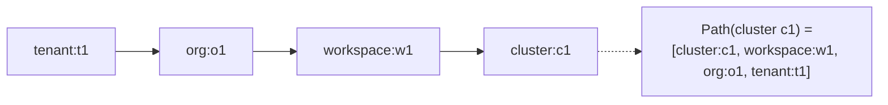

- **The host passes the ancestors** on every call, read from where it stores them. The package
  never looks a resource up for a check, so a check costs one statement, the subject's label
  values' grants and denies among what it reads, and more only where it needs its grants'
  conditions. `ResourceOf` is asked only
  when a change needs a scope's own ancestors, labels or attributes.
- **For lists, the host stores the path** in a `text[]` column with a GIN index, and `Filter`
  matches it and tests its first key's type, so one table can hold resources of several types.

## A check

`Authorize` answers whether a subject may do one permission on one resource. It reads in one
statement, the grants and denies on the tenant its label values are decided by too, apart from the
conditions of conditional grants, read only when no unconditional grant allows, and refuses unless
something allows. So a label is decided by the values the subject held as it held its grants.

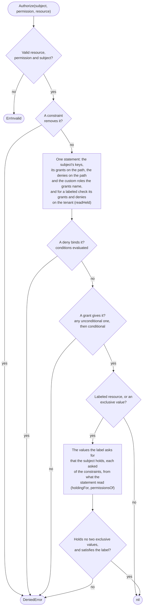

The layers, in the order a check applies them:

| Layer | Who sets it | Effect |
|---|---|---|
| Constraints | The host, in `Config.Constraints` | Removes a permission above every grant and deny. A tenant can't change it. |
| Denies | A tenant, with `SetDeny`, on a scope | Removes a permission from principals on the scope and under it, unless exempt. No deny removes `<type>:deny`. |
| Grants | A tenant, with `Apply`, on a scope | Gives a role's permissions on the scope and under it, perhaps under a condition. |
| Exclusive values | The host marks a dimension `Exclusive` | A subject able to hold two values of one holds none. |
| Labels | The host declares dimensions; tenants grant values | A labeled resource is allowed only to a subject whose values satisfy its label. |

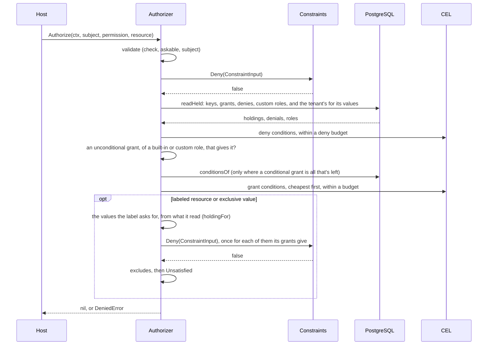

- **Explain** decides the same way and says why: every grant that allows, or the deny, constraint
  or label that refused, a label's or an exclusive value's dimension in `Decision.Label`. It reads
  the subject's keys, grants and denies in one snapshot, and what its label values are decided by
  in it too.
- **Permissions** lists everything a subject may do on a resource, deciding each as Authorize
  would.
- **Conditions** are CEL over `subject`, `resource`, `request` and `action`, typed by
  `Config.Attributes`. Each is compiled once, bounded in cost, and fails closed: a condition that
  errors gives nothing, and a deny's that errors denies. Each runs within the most evaluating it
  can cost, which its literals and types bound, and the ids, kinds, types and tenant a check
  passes and its action, which are no longer than `MaxID`. What a check reads together is bounded
  where it is stored, for each scope: an identity's conditional grants, the conditional grants to
  groups, the tenant's members and the public, each the tenant's and those from each source the
  host owns apart, the conditional denies, and the requirements of groups' eligibilities for a
  role, and a change adding a condition past one is refused as invalid. A check's budget is that
  for each scope on its path, so it evaluates every condition it reads, and no grant made beside
  another changes what that one decides. Conditions stored before there were bounds may be past
  one, and so may those another version of CEL bounds: each process bounds a stored condition
  again by what the CEL it is built with makes of it, its macros and types, so an upgrade can
  bound one more. `TestStoredConditionsKeepTheirBounds` pins the bounds of conditions of common
  shapes, so that one an upgrade moves shows in review. A change adding no condition to them isn't
  refused, and a check evaluates them cheapest first within its budget.

## A change

`Apply` grants and revokes on one scope as an actor. Every change an actor makes follows the same
shape: it is decided once before its transaction, so `ValidateGrant`, the constraints and
`ResourceOf` run outside it, then again under its locks. The locks hold what the change writes, but
not what its actor's access rests on: the actor's grants, its membership and places in groups, and
those groups' grants. So two changes that each take away what the other's actor acts by can both
commit, a write skew: a manager removing another from the group that lets it change members, while
that one removes the first from theirs, both succeed, though either after the other is refused, and
no one is left to change members. Such a race grants only what each change's actor could grant
when it was decided, but more can stand at once than one after the other would leave: two changes
that each also grant, as adding a member while removing the other manager, leave both grants, where
the second, made after the first, is refused. It never lets in anyone an actor couldn't have let
in, but can take more away, as locking the tenant's admins out. The host undoes it with its own
writes, as `ImportMembers`, `Import` or `SetMemberships`, which no actor's access decides. Locking
what each actor acts by would close it, at the price of taking, for every change, a lock for each
group the actor acts through, which past 64 would lock the whole tenant for every change by an
actor in that many.

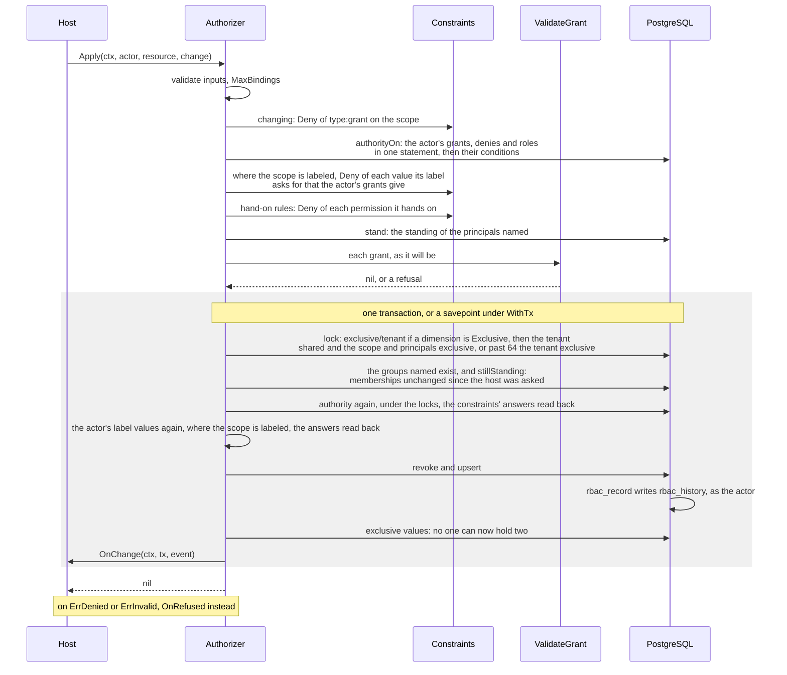

- **Who may change grants.** The actor needs `<type>:grant` on the scope. Through a role with
  `GrantableRoles`, it may grant only those roles, without holding them. Through any other role, it
  may grant a role only if it holds every permission of it, for every type the grant reaches.
  Either way, a limited grant permission can't mint a larger one.
- **Freezes.** A constraint removing `<type>:grant` from the actor on a scope, as a host freezes
  changes under a container, or a deny on its path doing so, stops `Apply` changing grants there,
  revoking them too.
  Every change an actor makes that takes access away there is stopped alike, whatever the actor's
  grants, as it needn't hold what it takes away: `SetRole` narrowing and `DeleteRole` deleting a
  role granted there (`changesStopped`, `scopesDenied`); `ChangeMembers` removing a member of a
  group holding access there, ending its place sooner, ending an activation made through the group
  there, or adding a member to a group a deny there names (`reachCheck.stopped`); and
  `DeleteGroup` with grants or eligibilities in force on the group's scope. Each is stopped by what
  it ends there, not by what the members hold after it, as `Apply` revoking a grant held twice is:
  a member leaving a group ends what the group and those it is in give it there, though another
  group gives it the same, but a place ending while another, from another source, keeps the member
  in the group as long leaves nothing (`placesLeft`). `SetRole` and `DeleteRole` ask the
  constraints of no resource, and read the denies on the tenant as on the tenant, once for every type
  of scope the role's grants can be on (`changesStopped`, `changesDenied`), where a deny's condition
  reading the resource can't be evaluated and so denies (`handsOn`): stricter than `Apply` on a scope
  such a condition spares, as the grants span scopes no one reads, but never weaker, and only for a
  deny below the tenant or a label is each scope read from the host. `ChangeMembers` asks the
  constraints once about each type of scope a member only loses access on, of no resource
  (`freezes`), and reads the types whose power to change grants a deny binding the actor lists
  (`grantsDenied`); only for a scope of a type either names, or whose label can refuse the actor, is
  `Config.ResourceOf` asked, and then the constraints again about it and the denies on its path, in
  one read with the rest (`reachAuthority`). In its transaction the denies are read again, and a
  type one binding the actor now names that none did refuses the change with `ErrConflict`.
  `DeleteGroup` reads the group alike: from the host only where labels are declared, or a
  constraint or such a deny may stop it changing grants on groups, so a condition reading the
  group's attributes reads what the host passes `Apply` there, and without `Config.ResourceOf`,
  where the group as stored isn't all of it, refused once its transaction finds anything granted on
  it (`storedWhole`), but for a label alone where the actor's label values satisfy every label,
  which its transaction reads again (`stillClearsAll`); and where no such deny bound the actor
  before it, one that does under its locks has it tried again. The host's own writes make no check
  of an actor, so no freeze stops them.
- **Until when.** What the actor holds only until a time, through an expiring grant, an activation,
  or a membership or place in a group that ends, it hands on only until then: `authorityOn` reads
  when each grant's holding ends, in the statement that reads the grants, and a grant may end no
  later than the latest holding of each permission it hands on. An eligibility, a custom role's
  definition and a place in a group that gains an eligibility need what they hand on held for good.
  Of the grants that count under a grant's condition, a decision reads only the role of each, how
  its principal carries it and whether it lasts until the grant ends, so `decidedAs` decides a grant
  until the soonest time at or after its end that the longest lasting of a kind of them ends, and
  grants ending between two such times share a decision: grants of one role to the actor's many
  groups, each ending at its own hour, are one kind, so a change granting a role to a thousand
  principals, each until its own hour, walks the roles it lists once. `heldFor` and `under` read how
  long the actor's grants give each permission, and the power to change grants, once for each
  question, whatever end it asks about, so each later end is one comparison.
- **Standing.** The host's answers rest on who is a member of what. `stand` fingerprints the
  memberships behind them, and `stillStanding` refuses the change with `ErrConflict` if any changed
  while the change waited for its locks.
- **Sources.** Grants, groups and members from a source in `Config.Sources` are the host's: only
  `Import`, `ImportGroups`, `ImportMembers` and the host's deletes change them.
- **Custom roles.** `SetRole` redefines a role in place for every grant of it, so it asks
  `ValidateGrant` about every grant and eligibility the new definition widens, before its
  transaction, and under the tenant's lock refuses with `ErrConflict` if those changed meanwhile.
  A grant widens by what it gives through its principal, as checks read it
  (`redefinition.widensTo`): one to the tenant's members of a privileged role, or to the public of
  a role not marked `Public`, gives nothing, and widens once the role gives it something, however
  the role changed, as narrowing it so that it is no longer privileged does. On each scope a grant
  that widens is on, the denies on its path that remove from the actor a permission the role will
  give refuse the change, as they would refuse `Apply` granting it there; on the others, only those
  removing its power to change grants there do. A grant to the tenant's members of a privileged
  role is read there as one to a principal named one by one (`widenedTo.reaches`): a catalog
  change that has the role no longer be privileged gives them what it gives, what the redefinition
  added too, and asks no one. A scope read as stored, as the host no longer has it, that the change
  comes to give more on while it waits refuses it with `ErrConflict`. A role's lists are compared
  sorted and without repeats (`canonical`), as one written around the package can hold them in any
  order, so renaming it is no redefinition, and setting a role, deny or eligibility again as it is
  stored changes nothing (`canonicalSQL`). A role lists in `GrantableRoles` only roles one of its
  `<type>:grant` permissions, on a type it is for, lets its holders grant (`lets`), so `holdsRole`
  checks the actor's power to grant each. It keeps a listing that already hands nothing on as
  stored, as once the role listed was narrowed, so renaming it needs only the power to define it.
- **Eligibilities.** `SetEligibility` lets a principal `Activate` a role for a while, perhaps
  only with approvers or a `requires` condition. An activation is a grant that ends no later than
  its eligibility expires, or its holder's membership or place in the group the eligibility names
  ends. It records the eligibility it was made through, by its principal's key
  (`activated_through`) and its id (`eligibility_id`), and rests on its holder reaching that
  principal: its own identity, through its membership, or a group, through the places in groups
  from it. Of the eligibilities that allow it, it is made through the one whose path from the
  holder lasts longest; of those lasting alike, one needing no approval, then its own, whose path
  every other rests on too, so leaving a group ends none its own eligibility would keep unless that
  needs an approval the group's doesn't; their requirements are evaluated cheapest first, as a
  check's conditions are, and the choice is made of those that hold. Between groups whose paths
  last alike it is by their approvers, requirements and keys, so leaving one can still end an
  activation another would keep. A change ending a membership or a place sooner, or removing it,
  holds it, in order, reads the activations of the identities it ends it for, and once it has
  ended it holds them and, in a later statement, cuts each short to the latest end of the paths
  left to its principal, or ends it, whatever another eligibility would allow: worked out again
  from every eligibility the holder reaches, one whose requirement or approver it never met would
  count. Held, a change ending another of an activation's paths at once waits for it, and reads
  the paths it left: each reading them first would read the other's as left, and neither cut it.
  `Activate` holds the places it can rest on until it commits, in the statement that reads the
  keys it finds its subject eligible through, so the two wait for each other, and a place nested
  between them makes no one eligible. Setting the eligibility again or deleting it leaves its
  activations to their own ends, or to their holders leaving its group: where labels or a freeze
  can refuse it, `ChangeMembers` reads the activations of the members leaving made through the
  groups it reaches, each principal's once however many of its places end (`activatedBy`), and
  checks each one's scope as a revoke there, and `DeleteGroup` refuses a group
  they rest on. Both read them only once they hold the places they end (`restingIn`, and
  `unrested` once `removeGroups` holds them), so an activation `Activate` commits while one waits
  for them, through an eligibility deleted meanwhile, is read as one made before: `ChangeMembers`
  finds it in `stillReached`, which it hadn't checked, and is tried again (`ErrConflict`), and
  `DeleteGroup` refuses it. Read before them, it would be ended unchecked.
- **Approvals.** Approving decides access on the scope, so on a labeled one an approval counts
  only from an approver whose own label values satisfy the label: read before the transaction and
  again under its locks, with the constraints' answers on them sealed, as an actor's are, and
  with none of a request's attributes, as the one passed is the activator's: any read of
  `request.attributes` by a condition of them, a test of an attribute's presence included, fails,
  so a grant's gives nothing and a deny's applies. `SetEligibility` doesn't check the approvers it
  names, whose values, and their groups' members, change after it: `Activate` checks the one
  approving.
- **Activations stored before migration 0012** record what migrating found: the one eligibility
  for their role on their scope whose principal their holder reached then, or, where it reached
  several or none, nothing. The first change re-checking one that records nothing ends it, as which
  path it rested on can't be told; activating again until later records it. The package had no
  release before it, so only a developer's database holds them, and none lasts past
  `MaxActivation`.

## Lists and searches

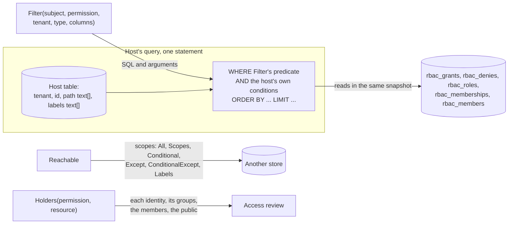

- **Filter** returns a condition for the host's own query, which reads the grants in the same
  statement as the rows, so sorting and pagination work and nothing changes between deciding and
  reading, for the query it was built for: build one for each. It never keeps a row Authorize would
  refuse. It keeps only the rows whose own key is of the listed type, as a grant on a container
  reaches every row under it, of any type, so one table can hold several. The planner has no
  statistics of a path's first key and counts a test of it alone as keeping one row in 200, which
  would turn a sorted page of a table of one type, whose condition no index serves, into a read and
  sort of the whole tenant. So the type picks the keys a row's denies are looked up by, which the
  planner counts alike whatever they are: a row of another type has none, so its lookup is unknown
  rather than false, and the row is left out. The subject's grants are matched through the path's
  GIN index, which merges the rows each finds, so its cost for each row grows with their number.
  Past a few on resources of the listed type, each row's own key is looked up in a hash of them, and
  past 128 on containers and the tenant, or past a few alongside those, each of its keys in one
  object of them all, so one with a grant on everything it created costs a row a few lookups; no
  index serves that, so the query reads every row of the tenant its other conditions keep. Denies
  are looked up so whatever their number: those on resources of the type by the row's own key, and
  those on containers and the tenant by each of its keys. Those naming the subject or its groups are
  read by those keys alone. Those naming the public or the tenant's members bind everyone, and any
  number of them can be on scopes of other types, which no index tells apart: while fewer than 16
  denies are on scopes of the types a list reads, it reads those by type, and otherwise finds the
  ones naming everyone by those keys, so a tenant with many of both has every list read every deny
  naming everyone.
- **Reachable** returns the same as scopes, for a host that keeps its resources elsewhere. They hold
  for resources of the listed type alone: a scope reaches everything under it, of any type, so a
  store holding several keeps to the type itself. Conditional grants and conditional denies come
  back apart, to check one by one.
- **Holders** lists who may do a permission on a resource, for an access review. That is each
  identity, through its own grants and its groups', with the tenant's members and the public as
  one holder each. It marks holders that hold only under a condition, or that a deny, a
  constraint or a label may refuse. For a labeled resource it reads every identity's label values'
  grants and denies in one statement in the list's snapshot.

## Labels and exclusive values

A label is mandatory access control above every grant. The host declares dimensions in
`Config.Labels`. A subject holds a dimension's values as permissions, `dimension:value`, which
roles granted on the tenant give, and a labeled resource is allowed only to a subject whose values
satisfy its label.

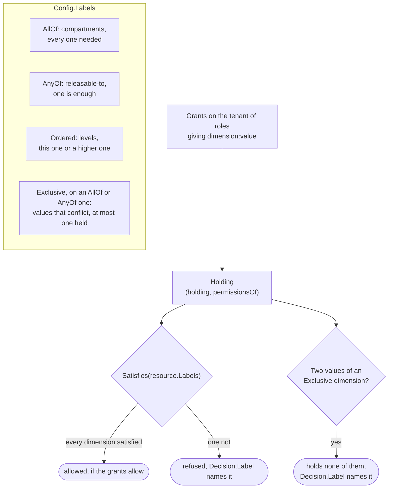

- **Values are decided on the bare tenant.** Every check decides a label value or a power to release
  on the tenant with no attributes or label, whatever tenant resource it is passed, as `Holding`
  reads them for a labeled check, which can't know what tenant the host means. So a check of a value
  and a check of a label agree, and an actor hands one on only as it holds it. A condition of theirs
  can't read the tenant's attributes: any read of them fails, a test of one's presence included, so
  a grant's gives nothing and a deny's denies, rather than hold or lift for what the bare tenant
  lacks. A constraint deciding them by the tenant's state reads it itself, through its `q`.
- **A change decides each value once.** A change checking the labels of many scopes by one read of
  the actor's values, as one to the members of many groups, decides each value once in each phase,
  when a label first asks for it (`decidedBy`), and shares what the conditions it evaluated came to
  across them (`runs`), so a condition that doesn't read the action runs once for all of them. Each
  value is still decided on budgets of its own, which pay for every condition they read, whether
  they ran it or a value before them did, so it decides as a check of it alone would, and what one
  label asked for first never changes what another is decided by.
- **Releasing and writing.** `ReleasePermission(dimension)`, held on the tenant, is the power to
  release data to a looser label in that dimension, so only a holder of it can downgrade data. A
  `Holding`'s `MayWrite` and `MayRelease` say whether data read under one label may be written, or
  released, under another.
- **Exclusive values are checked when they change.** A change that would let anyone hold two
  values of an Exclusive dimension is refused, after its writes and under its locks. `Conflicts`
  lists anyone left able to, as a catalog change can leave them. Which values an actor holds none
  of, and so can't hand on, a change reaching many scopes decides from each path's grants
  (`authorities`), reading each of its roles' permissions once for all of them. Where no dimension
  is exclusive, nothing is read.

## Transactions and locks

Changes take PostgreSQL advisory locks, keyed by the schema holding the tables, as every session
reaching them names it whatever its search_path, so two changes to the same rows run
one after the other, each taking its locks in one order. A key gives the schema and the tenant
each with its length, as either may hold `/`, so the locks of two tenants never meet. The locks
last until the transaction ends, so under `WithTx` two host transactions changing the same scopes
or principals in opposite orders can still deadlock, as can a change that also writes rows it
doesn't lock: PostgreSQL fails one, which matches `ErrConflict`.

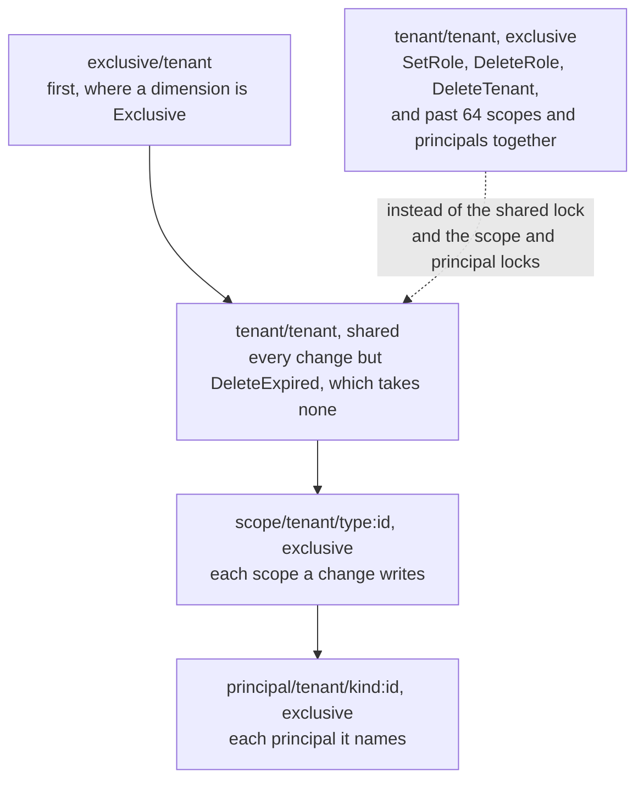

- **READ COMMITTED.** A change runs at READ COMMITTED, as its checks under the locks must read what
  committed before the locks were taken. Under `WithTx` the host's transaction must be at READ
  COMMITTED too, as must one `Migrate` is given.
- **Rows in one order.** `DeleteScopes` holds its scopes' locks and `DeletePrincipal` its
  principal's, so neither waits for the other, and both delete the principal's grants and
  eligibilities on those scopes: each locks them in the order of their scopes first, eligibilities
  before grants, so they don't deadlock. A revoke locks the grants it deletes in that order too, as
  a change ending places in groups ends activations among them without their scope's lock. Every
  change holds grants last, after its places and memberships, as `Activate` holds the places an
  activation rests on before its grant. A change ending places holds them before it reads what
  rests on them: `ChangeMembers` right after its advisory locks, before what it reaches is read
  again, and `DeleteGroup` in `removeGroups`, after the eligibilities and denies it removes, in the
  order the deletes take them, before it reads its members' activations. `DeleteRole` removes a
  role's grants before its eligibilities, but holds the tenant's lock exclusive, so no change runs
  beside it but `DeleteExpired`, which waits on no row.
- **One snapshot for reads in several statements.** Explain, Reachable and Holders read in one
  REPEATABLE READ, READ ONLY transaction of their own on a pool, and AsOf in a REPEATABLE READ one
  it rolls back. Explain, Reachable and Holders read what label values are decided by in it, and
  decide them after it, as the constraints are asked outside it. Under `WithTx` they read on the
  host's transaction at its isolation, AsOf in a savepoint: at READ COMMITTED each statement reads
  a moment of its own, so a change committing between two can mix two states, and for AsOf, history
  of a time not yet final. Conflicts reads in one statement, the custom roles with their grants, as
  a check and `broadExcludes` read them, so it lists what one moment held under `WithTx` too: it
  runs in such a transaction of its own only to hold JIT off for it (`withoutJIT`).
- **One time for a call.** A call reads `Config.Now` once, where it first needs the time: every
  statement it makes compares expiry with it, and every condition reads it as `request.time`, so a
  grant or a membership ending as the call runs can't meet a deny, a condition or label values of a
  later moment. A change reads it again in its transaction, which first needs it under its locks,
  where it decides again by what committed before them. As of a time, it is that time.
- **Races** PostgreSQL refuses, such as a serialization failure, a deadlock between host
  transactions, or a lock waited for past `lock_timeout`, as one a migration holds, match
  `ErrConflict`, still wrapping PostgreSQL's error: try again. Every exported call maps them, as it
  returns (`conflicting`) where it queries outside `begin`, which maps its own, wherever an error
  holds one, beside others too, as `errors.As` reads one, reading at most a thousand of its errors,
  as one that wraps itself has no end (`raced`), so one refused before a change's transaction, as
  in the reads that decide a change first, which under `WithTx` run on the host's transaction
  itself and can deadlock with a migration, in a read, or in a hook's statement, whose error a call
  returns as it is, matches too. Under `WithTx` the host runs its transaction again from its start:
  a statement refused on it outside a savepoint aborts it, and a savepoint, rolled back to, frees
  nothing taken before it, which the race can be over.
- **Migrating.** `Migrate` applies each pending migration in a transaction of its own, under an
  advisory lock on the schema that holds another replica's migration back, and records it as it
  commits: so a migration takes its locks in the order it names them, the tables before history,
  whatever was pending before it, and a failure leaves the database at the last migration recorded,
  where code from before it can run on, so each migration must leave the tables as that code can
  use them. A migration waits at most 100 ms for any lock on the tables, as it holds those it took
  meanwhile, and gives way: `Migrate` rolls it back and tries it again, up to 10 times. That wait
  ends before PostgreSQL's deadlock check, which alone cancels an autovacuum worker blocking a lock,
  once a wait passes `deadlock_timeout`: where an autovacuum worker holds one of the tables as a
  migration gives way, the next try first takes each such table's `SHARE UPDATE EXCLUSIVE` lock,
  waiting a second past `deadlock_timeout` (`outwaitVacuum`, from `pg_locks` and the vacuum and
  analysis progress views, which any role reads), and then the migration's own. That lock conflicts
  with none a check, list or change takes, so none waits behind it while the migration holds none of
  its own. Each table is locked in a savepoint of its own: where its wait ends, as for a vacuum to
  prevent wraparound, which PostgreSQL never cancels, the try rolls back to that savepoint and goes
  on without that table's lock, to the next table's wait, and each try after waits so again, some 20
  seconds more over the 10 tries for each such table with the default `deadlock_timeout`. A wait for
  another replica's migration is bounded by the session's `lock_timeout` alone, and not tried again.
  On a host's transaction `Migrate` applies them all in one savepoint, with neither the bound nor
  the tries, as rolling back to the savepoint frees nothing the host took before.

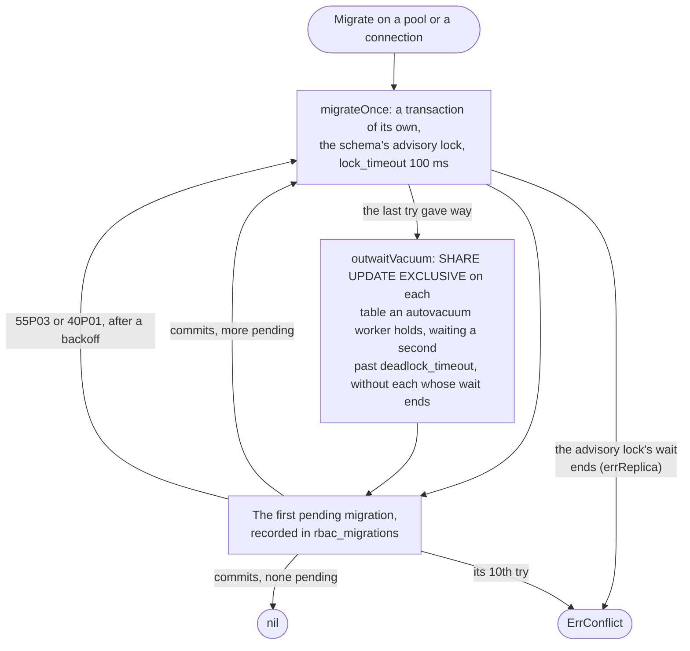

## History, export and AsOf

- **What a record holds.** Each holds the row as it was and as it became, when it took effect, the
  database role that wrote it, and the actor and call it was made through, with what the host
  attached. A change takes effect when its statement began, or its transaction where that began
  later, as in a procedure that commits as it goes, and an expiry when it expired, but never before
  the row's last record: so none but an expiry, which ends only what reads counted as expired
  already, takes effect before its transaction began, and what AsOf reads of a time is final once
  every transaction begun by then has ended. A write that bypassed the package is recorded too, with
  no actor. The tables bound its row as the package bounds what it writes, but for the ids in a
  deny's or an eligibility's lists of principals, which they count in characters rather than bytes.
  A row of more than 1 MiB as jsonb, or a context of more than 1 MiB, fails its write, so no record
  is one `History` can't return. A row written before history was installed has one record from
  migrating, its baseline, dated when it was created, or at the epoch where that was before year 1
  or at its first instant.
- **History's order.** `History` reads records in transaction order, by the id each transaction
  takes at its first write, and only those of transactions older than every transaction still
  running, which have all ended. So a cursor never passes a record that commits later. That is
  not each row's order: a transaction that took its id first and changed a row after another
  committed a change to it is read first, though its change came after. A row's versions are in
  the order of their records' ids, in which they were written, as AsOf and PruneHistory read
  them, and a consumer replaying an export applies them so. Any transaction holding an id holds
  every read back, AsOf's too, whose views take one. It, `Export` and `PruneHistory` name history
  by its
  schema, as `AsOf` does, and their types by pg_catalog's, so a session's temporary table or type
  stands in for none of it. A schema the application's role made or can create in, first on its
  search_path, would: that role can do neither.
- **Generations.** A cursor names its generation: the database cluster, by its system and
  timeline, and the database and schema. Failing over or recovering to a point in time starts a
  new generation, which an export starts again from `Genesis`. A restore that starts none, as
  from a disk snapshot, keeps the generation: where it lost a cursor's last record, `History`
  refuses that cursor, and history is exported again from the start. Where it kept that record
  and lost what came after, nothing in the database tells it from recovering from a crash, so a
  restore that should start a generation is a recovery to a point in time.
- **No record goes from under a cursor.** A prune records, for each of its transactions that
  deleted any, the last record it deleted in `History`'s order, and `History` refuses the cursor
  of an export that began before the prune where it is before that record, in the statement that
  checks the cursor and again in the one that reads after it, as a prune can commit between them:
  an export further behind than the cursor a prune went through would otherwise read on past what
  it deleted, and chain the rest as all history held. An export that began after the prune reads
  history as it left it, and stands where an earlier one could: its cursor's `Horizon`, the oldest
  transaction running as its first read from the start began, tells them apart, as a prune of an
  earlier transaction had ended by then. A read from the start reads nothing while a prune it sees
  is of a transaction no older than the oldest running, which it would count as one since.
  History's index of prunes (`rbac_history_prunes`) finds those recorded after a cursor and from
  its horizon on, which are few; a prune is recorded after what it deletes, so no earlier one can
  have deleted past the cursor. A delete from history, which only a role with the rights of
  history's owner gets past the append-only trigger, is refused as its transaction commits
  (`rbac_history_pruned`) unless a prune that transaction records reaches the record, by the last
  it deleted or, for a prune recorded before 0020, the cursor it went through, and the record is of
  an earlier transaction.
- **The export chain.** `Export` hashes each record onto the last checkpoint with SHA-256 and signs
  the checkpoint with the host's `crypto.Signer`: ECDSA on P-256, P-384 or P-521, Ed25519, or RSA
  of at least 3072 bits, each verified with the Go standard library. `VerifyChain` checks a run of
  records between two checkpoints.
- **AsOf** stands temporary views of history in for the tables, in a transaction it rolls back,
  so every check, list and search answers as it would have at a past time, with the catalog and
  the label dimensions as they are now. Making the views takes a transaction id, which holds every
  export in the cluster back while the read runs. Every statement is planned for its arguments and
  runs without JIT, which such plans over history cost past `jit_above_cost` for any subject. It
  takes a time from PostgreSQL's earliest to 9999-12-30, to the microsecond, rounded down, as pgx
  sends it, and a later one as another.
  Each statement reads history by the rows it names, through
  history's indexes, as a search the custom roles its grants name, by their ids, and its principals'
  grants by principal and type, which history's index of a principal's versions holds beside the
  scope, as a check seeks them on its resource's path. The view of custom roles takes each one's
  newest version, testing none for a later one, so `Grantable`, which can offer any, reads each
  version once.
- **PruneHistory** deletes only what an export has read and later versions supersede. It keeps
  each row's last version at or before its time, so AsOf answers as before for any later time,
  and refuses an earlier one; of a row whose last version by then ended it, it deletes every
  version, the end last. It reads history `MaxPrune` records at a time, each in a transaction of
  its own, so none holds exports back for long however long history is. Each that deleted records
  is recorded in history, in the statement that deletes, with the last record it deleted, and AsOf
  finds the latest prune's time by history's index. With several exports, it prunes through the
  cursor of the one furthest behind.

## Database roles

The application's database role must not be able to rewrite history, so the schema is set up with
three roles, and that role is no superuser and holds no role with a superuser's power or a way to
it: not `pg_write_all_data` or `pg_create_subscription`, through which it could write history, nor
`pg_execute_server_program`, `pg_write_server_files` or `pg_read_server_files`, which run programs
and write and read files as the server; before PostgreSQL 16 it has no `CREATEROLE`, which makes it
a member of any role but a superuser; it has no `REPLICATION` attribute, which reads every data
file, nor `SET` or `ALTER SYSTEM` on a parameter only a superuser may set. The README's
[History](../README.md#history) section has the exact grants.

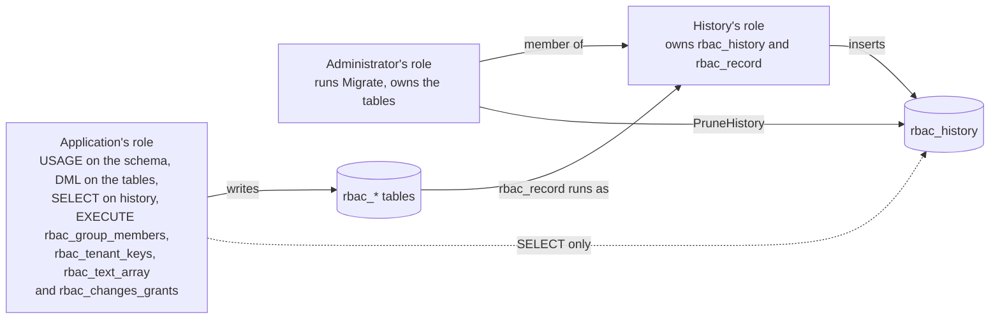

## Bounds

Every input that could grow without limit is bounded, so no call's cost depends on what a tenant
chose to store beyond these, but for the groups a subject is in through others (below) and for the
lists, which read what they list: `Filter` reads the subject's grants on the scopes that can reach
the listed type and the denies on them, and costs each row a few lookups among them however many
there are; and for the changes that check, once each, every scope what they change has access on:
`ChangeMembers` every scope the groups whose members change have access on, approve eligibilities on
or are named or exempt in a deny on, and `SetRole` changing what a role gives, and `DeleteRole`,
every scope it is granted on; and for the denies binding the actor of `ChangeMembers` or
`DeleteGroup` that remove a power to change grants, which they read wherever in the tenant they are,
as a deny on the path of a scope of a type one lists can stop them taking access away there, through
an index of those alone, so no other deny naming the actor, its groups, the tenant's members or the
public costs them anything; and for `ImportMembers`, which asks `ValidateGrant` once for each
member it adds and each grant or eligibility that member gains. The tables hold rows within the same
bounds, but for the ids in a deny's principals and exemptions and an eligibility's approvers: a
check can count an array element's bytes only with a function of the package's own, which every role
writing the table would need `EXECUTE` on, so the tables count those in characters, to `MaxID`, and
a role that writes around the package can store them at up to four times as many bytes. History
refuses a row of more than 1 MiB as jsonb all the same.

| Bound | Value | What it limits |
|---|---|---|
| `MaxID` | 512 bytes | A tenant's, scope's or principal's id. |
| `MaxBindings` | 1,000 | Bindings in one `Apply`, and the grants, memberships, groups or members one `Import`, `DeleteGrants`, `SetMemberships`, `ImportGroups`, `DeleteGroups`, `ImportMembers`, `ChangeMembers` or `DeleteMembers` takes, and the grants and eligibilities the members one `ChangeMembers` adds gain, each member's counted apart, by its principal, as `ValidateGrant` is asked about each, but no more than one place alone gains, whatever its group and those it is in hold. The host's own `ImportMembers` is asked about each with no such bound. |
| `MaxGrantsPerRole` | 20 | Grants in force of one role to one principal on one scope, differing by source, expiry or condition. Those from each source the host owns count apart. |
| `MaxDenies`, `MaxDenyEntries` | 100, 256 | Denies on a scope, and the principals, exemptions or permissions one names. |
| `MaxCustomRoles`, `MaxRoleEntries`, `MaxGrantableRoles` | 300, 1,000, 64 | Custom roles in a tenant, the permissions one gives and the types it is for, and roles one lists in `GrantableRoles`. |
| `MaxApprovers`, `MaxActivation` | 16, 366 days | An eligibility's approvers, and its longest activation. |
| `MaxGroupDepth` | 8 | How deeply groups nest. |
| `MaxPlacesInGroup` | 20 | Places in force of one principal in one group, each from another source. Those from each source the host owns count apart. |
| `MaxGroupsOfPrincipal` | 1,000 | Groups one principal, an identity or a group, is in directly, by places in force. Those from each source the host owns count apart. A check reads every group its subject is in, and every group those are in, `MaxGroupDepth` deep, which this bounds only level by level (below). |
| `MaxExpression` | 2,048 bytes | A condition's or requirement's expression. Its cost is bounded too. |
| What a check reads together | 80,000 units: hundreds of comparisons with literals, a hundred of an attribute with the subject's id, or three of the longest conditions that read a list or loop | The distinct conditions of an identity's conditional grants on a scope; of a scope's conditional grants to groups, the tenant's members and the public; each the tenant's and those from each source the host owns apart; of a scope's conditional denies; and the requirements of groups' eligibilities for a role on a scope. Each counts compiling it, 8 a byte, and the most evaluating it can cost, at most 10,000. On the tenant, one reading the action counts once for each label value it gives or denies. A check may spend this for each on each scope of its path. |
| `MaxConditionBytes` | 32 KiB | The conditions one `Apply` or `Import` carries, each distinct one counted once. |
| `MaxName`, `MaxDescription`, `MaxNote` | 128, 2,048, 2,048 characters | Names, titles and group ids, descriptions, and notes and justifications. |
| `MaxRequest` | 256 characters | A request id in `Audit`. |
| `MaxHistory`, `MaxHistoryBytes`, `MaxPrune` | 10,000, 64 MiB, 10,000 | Records read by one `History` call, the bytes of their rows' JSON and their text past the first, and records deleted by one prune. |

`MaxGroupsOfPrincipal` and `MaxGroupDepth` bound the groups a subject reaches only level by level. A
check reads every group its subject is in, and every group those are in, each once, so an identity
in 300 groups, each in 300 others, is within every bound, and each of its checks reads 90,300
groups, for over half a second: only the tenant's groups bound how many. Bounding the groups
reached would have each change nesting a group read, for every identity under it, every other
group that identity is in, under the lock that serializes nesting in the tenant: nesting a group of
20,000 identities, each in about 50 groups, would read a million rows, for seconds, while every
other nesting in the tenant waits. Keeping nesting narrow is the host's, and the group managers'.
