# Architecture

How the package is put together: what it stores, how a check, a change and a list each run, how
groups, labels and policies combine, and how history is kept. The [README](../README.md) is the
guide to using it; this is the map of how it works, for reviewers and contributors. Each diagram
names the functions and tables it shows, so it can be checked against the code.

- [Context](#context)
- [Inside the package](#inside-the-package)
- [Data model](#data-model)
- [Principals, groups and keys](#principals-groups-and-keys)
- [Resources, scopes and paths](#resources-scopes-and-paths)
- [A check](#a-check)
- [A change](#a-change)
- [Lists and searches](#lists-and-searches)
- [Labels and exclusive values](#labels-and-exclusive-values)
- [Transactions and locks](#transactions-and-locks)
- [History, export and AsOf](#history-export-and-asof)
- [Database roles](#database-roles)
- [Bounds](#bounds)

## Context

The package is a Go library that a host application links. It keeps everything in PostgreSQL, in
tables prefixed `rbac_` in one schema, and asks the host only through the hooks in `Config` and
the `crypto.Signer` an export is given. It runs no server and holds no state between calls but
compiled conditions.

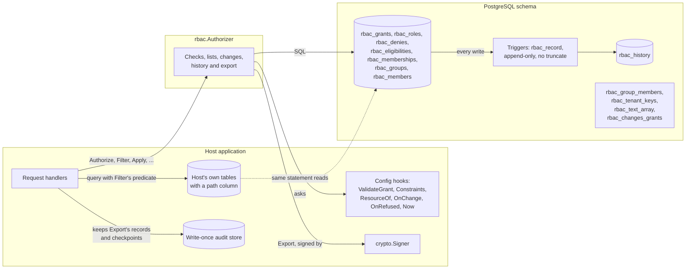

- **One database, one transaction.** A change runs in a transaction of its own, or under
  `WithTx` in a savepoint of the host's, so the host can create a resource and its creator's grant
  together.
- **The host owns identity and resources.** It says who a subject is (`Subject`) and what a
  resource is, with its ancestors and attributes (`Resource`). The package stores only grants,
  eligibilities, roles, denies, memberships and groups, and their history, keyed by the ids the
  host gives.
- **The host decides who may hold what.** `ValidateGrant` is asked about every grant and
  eligibility a change makes, and every place in a group, which gives what the group holds.
  `Constraints` remove permissions above anything a tenant grants. The host's own writes,
  `Import`, `ImportGroups`, `ImportMembers`, `SetMemberships` and the host's deletes, skip the
  checks made of an actor, but `Import` and `ImportMembers` still ask `ValidateGrant` about what
  they give.

## Inside the package

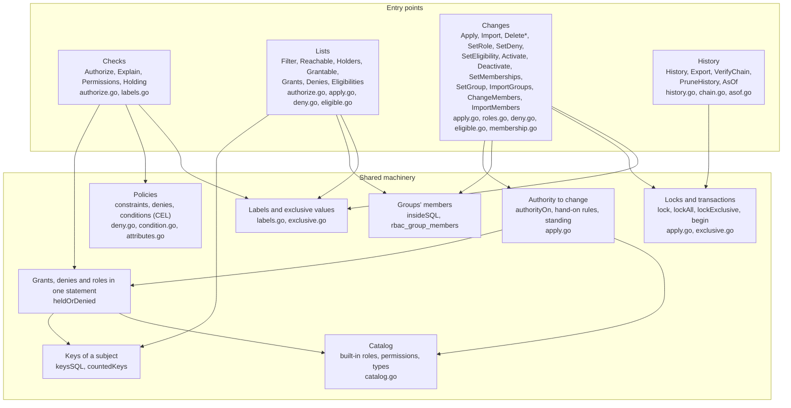

## Data model

Every row is a tenant's, by its `tenant` column: nothing is shared between tenants, and a tenant
is deleted with `DeleteTenant`. A scope is `type:id`, as `scope_type` and `scope_id`, with the
generated column `scope`. A principal is `kind:id`, as `principal_kind` and `principal_id`, with
the generated column `principal`.

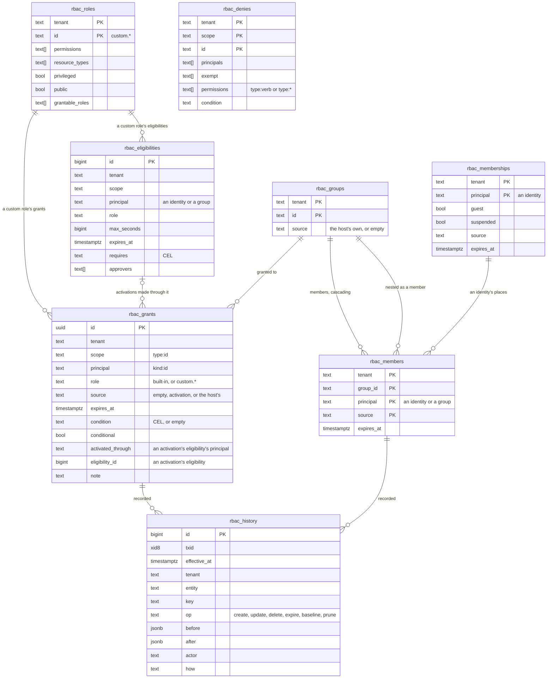

- **Built-in roles are not stored.** They are the host's `Config.Catalog`, so a deploy changes
  them for every tenant at once. Custom roles are a tenant's own, prefixed `custom.`, and give
  only permissions and types the catalog has.
- **A grant is one role to one principal on one scope**, from one source, until one time, under
  one condition. The key index `rbac_grants_key` holds what a check reads, so a check's read of
  grants is an index-only scan. The indexes by scope and by principal lead to both too and hold the
  same, so a connection's cached statement, once PostgreSQL plans it generically by the tables'
  averages, still reads only the subject's grants on the path, from the index alone, whichever
  index it picks. A check's read of its subject's grants and the denies on the path, and a change's
  of its actor's (`readHeld`), and of the powers to change grants the denies binding it remove
  (`grantsDenied`), are planned with sequential scans off (`indexed`, `planned`), so a plan
  PostgreSQL made generically while the tables were small, or by statistics from then, which it
  keeps until an analysis invalidates it, still reads each table by an index: one made with them on
  read every row of each, and the denies once for each key of the path, 2,000 pages of a check
  beside 20,000 denies and 2,500 of a change's read of its actor's authority, against 8 and 18 with
  them off. Each is sent in one batch, after a statement turning them off, which keeps the session's
  setting in a variable of the package's own, `rbac.enable_seqscan`, and before one putting it back:
  on a pool the batch is a transaction of its own, and under `WithTx` it runs in the host's, which
  goes on past it; where the statement fails, nothing after it runs, and a rollback puts the setting
  back. So are a change to members' reads of the grants, eligibilities and denies naming its groups
  (`reachOf`), which read every deny and eligibility in the database so, and its removal of the
  places it ends (`leave`), which deletes each by where it is stored, as `restingIn` holds it:
  matched beside `tenant = $1`, a plan made while the table was small read every place in the
  tenant and for each one every place in the table, 2.6 million pages to remove one member. A
  search reads its subject's own grants on scopes of the listed types a key at a time too
  (`heldByType`): by `= ANY` of its keys beside a type's range of scopes, a plan by no statistics
  read that range of the scopes' index, every grant on a scope of the type in the tenant. A search
  decides which custom roles the public's and the tenant's members' grants name before its
  statement, from `rbac_grants_custom_principal`, which holds only grants of custom roles, by
  principal and scope, and reads only those its subject counts: the anonymous and a guest read none
  of the members', and a search of a permission no public role gives none of the public's, so their
  grants of built-in roles on thousands of resources cost it nothing. It names a custom role as that
  index's predicate does, as a range of the C collation, from `custom.` to just before `custom/`,
  which no LIKE implies, so `rbac_grants_custom_role`, whose predicate is a LIKE and which leads to
  the tenant alone, serves no plan of it: by statistics from before the tenant granted custom roles,
  or with none, every plan read every grant of one in the tenant through it, to anyone, once for
  each broad key and scope or type. `SetRole` making a role privileged reads whether the tenant's
  members hold it so too, by their key, with sequential and bitmap scans off (`heldByMembers`): by
  the tenant and the role, it read every grant of the role in the tenant, and by fresh statistics of
  a role id other tenants grant too, as `EXISTS` plans for the first row, every grant in the table.
  A change bounding the conditions a check reads together on a scope (`conditionsIn`) reads the
  conditional grants there by `rbac_grants_conditional`, which holds those alone, and one bounding
  groups' requirements for a role there (`requirementsBounded`) the eligibilities with one by
  `rbac_eligibilities_requires`, in its order, which no other index gives: each with sequential
  scans, bitmap scans and sorting off (`seeking`), so neither the scope's unconditional grants nor
  its other eligibilities cost it anything, however many, whatever the statistics count or the table
  held when the session planned the read. By the scope's index, which holds whether a grant is
  conditional but not its condition, every grant to a group there was read from the table, and with
  sequential scans on, a plan made while the table was small read every grant in it.
- **A read of a list of keys reads each key's rows on its own** (`byKey`), as of a list's scopes
  or principals, of the denies on a check's path, of `Activate`'s eligibilities and of the rows
  `DeleteScopes`, `DeletePrincipal` and `DeleteGroups` remove, and so does a walk through nested
  groups: a generic plan costs `= ANY` of a list as ten seeks, and a read of the tenant by an index
  on it alone as an average tenant's few rows, and would read every row of a large tenant. The rows
  a removal locks in order it then deletes by key, never matched to the tenant's in a semi-join,
  which such a plan runs by reading every one. The eligibilities a group approves and the
  denies that name or exempt it, which a change to its members and `DeleteGroup`'s check read,
  those an identity or group leaving the tenant is taken out of, and the denies naming a list's
  subject or its groups, which `Filter` and `Reachable` read, are found through GIN indexes on
  those arrays of keys, each key prefixed by its tenant (`rbac_tenant_keys`), so neither the
  tenant's other rows nor another tenant's group of the same id are read. The tenant's keys are
  built in a subquery, whose value no plan sees (`naming`), so every plan costs the search as one
  of a key: planned for an array a statement is given, as a connection's first five runs of a
  statement and every one as of a time are, a search for each of a few hundred keys cost more than
  reading every row of every tenant, and comparing each with every key, which took seconds beside
  another tenant's denies naming hundreds each. `DeleteGroup`, which asks only whether any names
  its groups, finds them in CTEs, which a plan reads for every row they hold: planned for the
  first, as `EXISTS` is, a read of every row looked to find one sooner. The denies binding the
  actor of a change to members or of `DeleteGroup` that remove a power to change grants, whose types
  they read wherever in the tenant the denies are (`grantsDenied`), before their transaction and in
  it with the actor's grants (`authoritiesIn`), are found through such an index
  holding only those (`rbac_denies_grants`, by `rbac_changes_grants`), so the other denies naming
  the tenant's members or the public, which bind every actor, aren't read. History indexes the keys
  each version of a deny names so too, so as of a time those lists find them the same way, and
  they count the denies on their types by history's versions of them, at most a few: through the
  views, which read every version of a deny to find its last, counting read every one, deleted
  denies' too.
- **A lookup of one key a tenant holds once** gives the key in a subquery too, whose value no plan
  sees, as whether a group exists (`groupExists`) or an identity is a member (`GroupsOf`, a search
  counting the tenant's members' grants, and the walk up from a subject's identity in every check,
  list and change, `keysSQL`): counted by the tenant's selectivity and the key's apart, as if
  neither told anything of the other, a key many tenants hold, as a group's id each names its admins
  by or an identity in many tenants, was counted in a large tenant as hundreds or thousands, and
  `EXISTS`, planned for the first, read every tenant's rows to find it sooner than the key's index,
  as the planner costs it, and a check of an identity in every tenant of a large one, counting each
  group it is in as many again, was costed past `jit_above_cost`, and compiled for 400 ms before
  reading in a tenth of a millisecond what it reads. Unseen, the key counts as one of the column's
  distinct values, and a tenant holds each at most once.
- **Activations are grants** from the source `activation` (`SourceActivation`), made by
  `Activate` from an eligibility, which they record, and ended by their expiry, `Deactivate`, or a
  change ending the membership or a place in a group on their holder's paths to that eligibility's
  principal sooner.
- **Every write is recorded.** Each table above but `rbac_history` has the trigger
  `rbac_record`, which writes the change into `rbac_history`. Nothing updates or truncates that
  table, and only `PruneHistory`, as a role with the rights of its owner, deletes from it, each
  delete reached by a prune its transaction records. Both triggers find history in the schema of
  the table they fire on, by a search_path each sets for its own run, so a session's own table
  named as history's stands in for none of it, whatever the schema is named, and refuse the row
  where that search_path can't name the schema, as `$user` or one their role has no `USAGE` on,
  before they read a table or call anything by it, so nothing such a table runs, as its row
  security policy, runs as history's role.
  Each record reads its key's last by history's index of each entity's keys, in a generic plan with
  sequential scans off: a plan its session made while history was small would otherwise scan all
  of it for each row, and one made for each row, until history is analyzed, read all of the
  tenant's records of the entity, so a statement writing many would take time growing with the
  square of their number.

## Principals, groups and keys

A check counts what the subject's principals hold. They are found in the same statement as the
grants (`keysSQL`), up from the identity: its membership of the tenant, the groups it is in, and
the groups those are in, each counted once, as deep as they nest, which changes keep to
`MaxGroupDepth`.

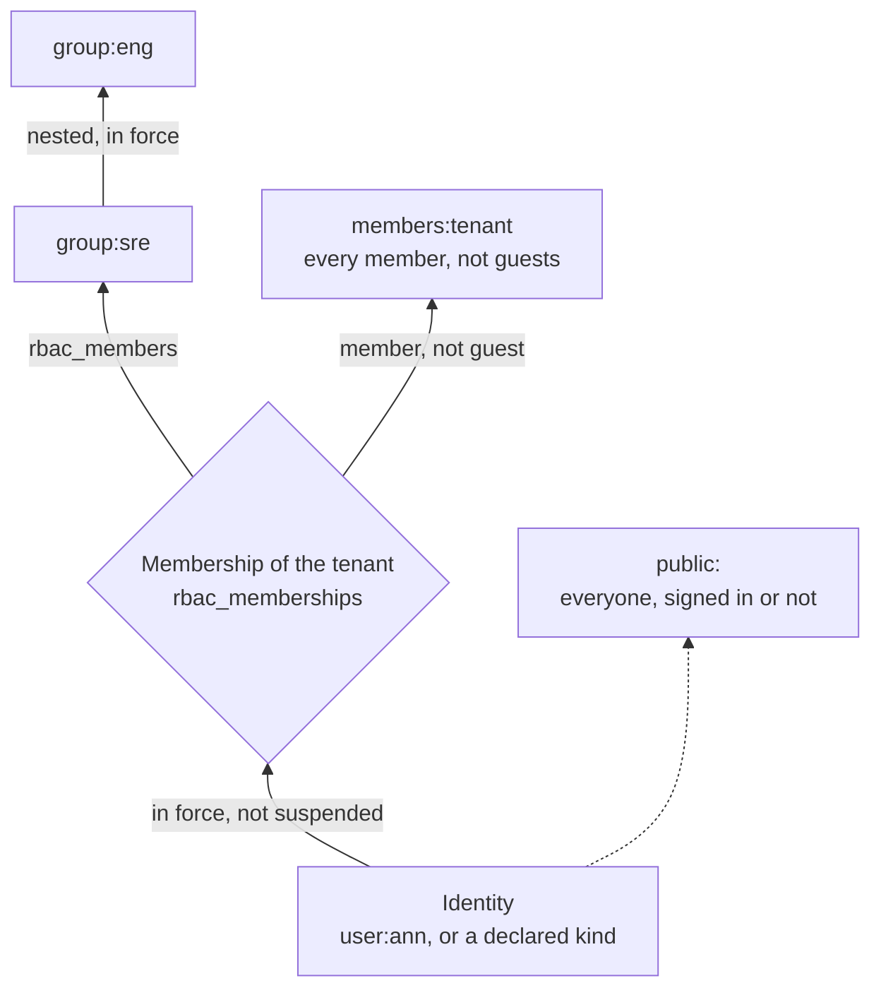

| Key | Counts for | Notes |
|---|---|---|
| `user:ann` | Its own grants | Only while it is a member or guest of the tenant, not suspended. |
| `group:sre` and the groups above it | The group's grants | Through each place in force, while the identity's membership is not suspended. |
| `members:<tenant>` | Grants to every member | Not to guests. Never a privileged role, nor one that changes access. |
| `public:` | Grants to everyone | Only roles marked `Public`, never a privileged one nor one that changes access. The anonymous subject holds these alone. |

- **Denies bind more widely than grants give.** A deny binds an identity through its groups and
  the tenant's members even while its membership is suspended, so suspending someone never lifts
  a deny (`bound`). A deny's exemptions are matched against every key the subject is in, the
  tenant's members too where a check of a permission that changes access counts none of their
  grants, and the identity's own (`exempted`).
- **Changing a group's members is granting.** Adding an identity to a group gives it what the group
  holds, so `ChangeMembers` needs the authority to grant all of it, and the host's `ValidateGrant`
  is asked as for a grant. The same holds for nesting one group in another, and a change that adds a
  member and nests its group asks about the member against every group it will be in. What a change
  reaches is read once (`reach`, indexed by the keys it names), however many members of a group
  change and however many of the groups are in one that reaches it, and its grants are decided once
  for each role, condition and end on a scope, as the member a grant names decides nothing of the
  actor's power to make it; only the host is asked about each member's, which `MaxBindings` bounds
  for `ChangeMembers` but for what one place alone gains. A member is its principal: what all the
  groups, and places in one, a change gives it reach is counted, and asked about, once for each end
  its places give it (`gainsWithin`, `askMemberships`), so a group two of them are in counts once,
  as does a group it is placed in from two sources until one end; past `MaxBindings`, a change
  gains no more than its largest place alone does, so joining several groups never multiplies what
  one change asks, nor what it builds: the grants it checks and the footprint `stillReached`
  compares are found from what each principal gains (`gained`), and from the groups holding it,
  not from each group that reaches them. `ImportMembers`, the host's own write, which no actor's access decides, asks it
  once for each member and each grant or eligibility the member gains, with no bound on them, so
  its cost grows with that.
- **Expanding down** from groups to their identities, for lists and changes, is `insideSQL`. It
  finds nested groups in the statement and their identities through `rbac_group_members`, which
  plans its query for the groups reached, so a small group's members are read alone however large
  the tenant's other groups. With their standing, as `Holders` reads them, it reads the members
  first, and then their memberships in a statement planned for their number: the planner counts a
  group's members by the tenant's selectivity and the group id's apart, so a large tenant's group
  of one whose id other tenants use too was counted as a thousand or more, and joined in one
  statement its memberships were hashed with every tenant's; looked up each by its key, a group of
  20,000 read 80,000 pages of memberships that fill 900. `Members` takes the identities whose
  membership stands from it, and looks only the rest up by key.

## Resources, scopes and paths

A `Resource` is a tenant, a type and an id, with its ancestors: the containers it is in, nearest
first, of the types in `Config.ContainerTypes`. Its path is its own key, then its ancestors', then
the tenant's. A grant or deny on any scope of the path reaches it.

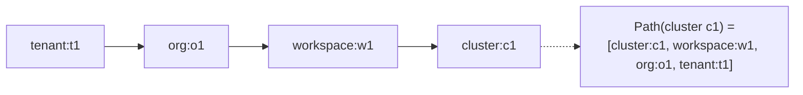

- **The host passes the ancestors** on every call, read from where it stores them. The package
  never looks a resource up for a check, so a check costs one statement, the subject's label
  values' grants and denies among what it reads, and more only where it needs its grants'
  conditions. `ResourceOf` is asked only
  when a change needs a scope's own ancestors, labels or attributes.
- **For lists, the host stores the path** in a `text[]` column with a GIN index, and `Filter`
  matches it and tests its first key's type, so one table can hold resources of several types.

## A check

`Authorize` answers whether a subject may do one permission on one resource. It reads in one
statement, the grants and denies on the tenant its label values are decided by too, apart from the
conditions of conditional grants, read only when no unconditional grant allows, and refuses unless
something allows. So a label is decided by the values the subject held as it held its grants.

The layers, in the order a check applies them:

| Layer | Who sets it | Effect |
|---|---|---|
| Constraints | The host, in `Config.Constraints` | Removes a permission above every grant and deny. A tenant can't change it. |
| Denies | A tenant, with `SetDeny`, on a scope | Removes a permission from principals on the scope and under it, unless exempt. No deny removes `<type>:deny`. |
| Grants | A tenant, with `Apply`, on a scope | Gives a role's permissions on the scope and under it, perhaps under a condition. |
| Exclusive values | The host marks a dimension `Exclusive` | A subject able to hold two values of one holds none. |
| Labels | The host declares dimensions; tenants grant values | A labeled resource is allowed only to a subject whose values satisfy its label. |

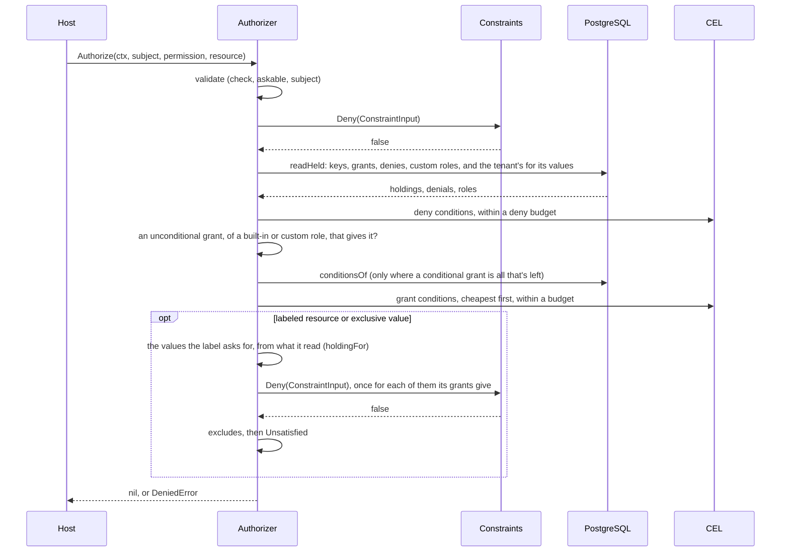

- **Explain** decides the same way and says why: every grant that allows, or the deny, constraint
  or label that refused, a label's or an exclusive value's dimension in `Decision.Label`. It reads
  the subject's keys, grants and denies in one snapshot, and what its label values are decided by
  in it too.
- **Permissions** lists everything a subject may do on a resource, deciding each as Authorize
  would.
- **Hooks are given copies** (`givenTo`, `copiedFor`): each constraint its own of the subject's and
  the resource's attributes, ancestors and label, and `ValidateGrant` its own of the actor's,
  `deepCopy` made once for a call (`still`), the first time it asks the hook about each, by where
  what the host passed points, and given again whenever it asks about the same, as `Permissions`
  does for each permission and a labeled check for each value its label asks for: copied for each
  ask, `Permissions` of 300 permissions on a resource of 20,000 tags took a second. A hook writing
  to its copy reads its write when the call asks it again, and nothing decided or asked of another
  hook does. A copy holds no more than a check converts (`maxConverted`), counted as converting
  counts it, each value, map, list, pointer and message what converting it costs (`mapCost`),
  whatever the copy shares or moves whole, so it counts what converting the same does, but for what
  JSON text and packed messages decode to, which it holds as bytes, and for a message, or a longer
  length of a slice, reached twice, which it copies once where converting counts it again: past it
  the hook can't be asked, and the call is refused (`uncopied`) as any other, a `DeniedError` of the
  permission on the resource asked about, or the tenant, whose `Reason` names the hook and whose
  message only the permission. Counting a list's elements twice, a string by the bytes of its
  header, a protobuf `Value` and its field apart, or a message a pointer reaches for the pointer and
  again for the message, attributes a check converts couldn't be copied, as a resource's nearly
  40,000 timestamps, which a check converts. A copy keeps each slice it copies apart from the maps,
  pointers and messages, changing it where it is kept as its elements are copied (`copied`), as five
  lookups of it for each element cost about what copying the element did. A slice reached at several
  lengths is copied once from where it starts, each length a slice of the copy, and one reached
  while its elements are copied, before a longer length outgrew that copy, a slice of its own, whose
  elements are copied too, as set in the longer alone it held the host's. A value holding no map,
  slice or pointer that an interface holds, as an array, is shared, as nothing writes to it through
  the interface. A call keeps what the host passed with each copy until it returns, so where it
  points is no other value's meanwhile: known only by where it points, a value dropped and collected
  during the call would leave its place to one made after, which would be given the first one's
  copy.
- **Conditions** are CEL over `subject`, `resource`, `request` and `action`, typed by
  `Config.Attributes`. Each is compiled once, bounded in cost, and fails closed: a condition that
  errors gives nothing, and a deny's that errors denies. A check converts what the host passes into
  CEL's own values once (`converter`), deeply, from a closed set of Go values (`Attributes`): bools,
  strings and numbers read by their kind, times, in UTC, as `request.time` is, durations, bytes,
  slices, arrays, pointers, maps
  keyed by bools, strings, ints or uints, JSON text and numbers, and the protobuf well-known types.
  It calls no method of the host's, so a condition reads no value by one. A kind's attributes, the
  subject's, the resource's or the request's, holding anything else anywhere, a `ref.Val` of the
  host's own, a list, map or optional of CEL's a host makes, a struct, another message, a map keyed
  by a double or holding two keys read as the same value, and so JSON text naming a member twice
  once unescaped, read through `json.Decoder`'s tokens (`parseJSON`), or a packed message setting a
  field or a map's key twice, read from its wire bytes (`setOnce`), as decoding either keeps the
  last where a reader of the first reads another, JSON text that isn't UTF-8 or escapes half a
  surrogate pair, a `json.Number` JSON doesn't write, a value holding itself, or nesting past
  `maxNested` along the longest path through them, can't be read as a whole (`unreadable`): every
  condition reading any of them fails, while the other kinds' are read. A value inside a readable
  map that no condition could read left every operator to tell it from the rest, and `in`, `has()`
  and loops over a map's keys each found its key; whole-kind failure leaves no such value for an
  operator to meet. The kinds that can't be read are each the one value `unreadable`, so whatever
  hashes or compares it fails too: a key (`comparableKey`), a comparison or `in` (`measured`), and a
  list or map literal holding it (`literal`), and the `subject`, `resource` and `request` holding it
  are read as it is, by their fields' names alone (`variable`), as a kind declarations refuse in
  part is, so no list or map an operator meets holds it; hashed, a map literal keyed by two kinds
  past `maxConverted` held one entry, and `request.attributes in {subject.attributes: true}` held.
  Built, a list holding it was decided by its size or by another value it held, as comparing reads
  the smaller value whole and no further, so `[subject.attributes] != []` held, and
  `[subject.attributes, 1] == [{}, 2]` failed for a kind that can't be read but was false for one
  refused in part, as that is larger; finding it there would read the larger value whole. A map
  literal naming a key twice fails whatever it holds, as CEL builds it holding the value named last
  and drops the one before unread, so `{"a": subject.attributes, "a": 1}.a == 1` held where
  `{"a": 1, "a": subject.attributes}.a == 1` failed. A double that isn't finite is kept out of
  lists and maps alike: a literal holding one fails as it is built, and an attribute holding one,
  however deep, which the converter counts (`infinite`), is an error that a declared kind refuses
  in part (`declared`), as a declared double that isn't finite is, and that makes a kind no
  declarations cover `unreadable`, as a value of another type does: no declarations name what its
  conditions read, and refused by name alone, a deny's
  `request.attributes.region == "eu" && request.attributes.risk > 0.5` lifted outside the EU for an
  infinite float64 risk, and applied for the same infinity as JSON text, `1e400`. So comparing
  fails where either operand is one, and no further search is needed; found only where comparing
  read it, it failed where the smaller value held one, and `[0.0 / 0.0, "<long>"] != [1, 2]` held.
  Depth is decided by heights kept with each converted value, so it doesn't
  turn on map order or on which kind reached a shared value first, and each kind is converted, and
  charged, whole, whatever it holds, but where it nests past `maxNested`: converting stops there, so
  what it is charged, and whether the kinds after it fit `maxConverted`, can turn on map order,
  failing closed. A map of structs, which no condition reads, is refused unread at 2 for each entry
  (`refusedWhole`), as reading an entry copies it whole: a map of 2,000 structs of 64 KiB took 7 ms,
  charged as much. Nothing else turns on map order, nor on the order of the kinds, whether a hook
  can be given a copy included (below), and a loop gives a map's keys in an order of its own
  (`stepping.order`, below): JSON text
  whose values may cost more than `maxConverted`, by its brackets, braces, commas and colons, each
  bracket and brace what building a list or an object costs (`jsonValues`), fails them all
  unparsed, where compared with
  what was left, it failed them where what came before it left less than it may hold, though what it
  holds fit, as `[]` holds less than its brackets count. A value reached twice
  is converted once, but for a resource's sharing it with the subject's or the request's (below),
  and converting costs a check at most `maxConverted`, counted as `valueSize` counts what a
  condition reads, but each map, `Struct` or JSON object 8, and each list, `ListValue` or JSON
  array, pointer, but to a message, and other message 4 (`mapCost`), as building each takes several
  times what converting a number does: charged one, 160,000 empty maps took 93 ms to convert, where
  as many ints took 12 ms. So weighed, a unit took 20 to 115 ns to convert and 25 to 200 ns to copy
  for a hook, whatever held it, a copy charging a struct a tenth of the bytes it sets whole, and a
  slice's elements, and a map's values, a tenth of the structs they hold in place, which it moves
  before copying each (`inlineTenths`), and a map's keys a tenth of the bytes of an array or a
  struct, which reading an entry moves and setting it hashes (`keyTenths`), each before it moves
  them, and of the strings such a key holds and what its interfaces hold, which hashing reads too
  (`payHashed`): charged one, a copy of 2,000 structs each holding a map beside 64 KiB took 38 ms,
  and of 2,000 entries keyed by arrays of 4 KiB 8 ms, and charged their bytes in place alone, of 50
  keyed by structs each holding a string of 1 MiB 1.4 ms, for 167. Nor does it move a slice's
  elements or a map's values where what they hold in place, at least one for each 24 bytes, costs
  more than is left (`leastCopied`): a map holding an array of 4 MiB allocated 12 MB, and 2,000
  arrays of 4,096 interfaces 133 MB, before being found past what a copy holds. A copy holds
  nothing nesting past `maxCopied`: it is
  refused there (`overflow`), where it held the zero value, or the copy of a value reached less
  deep before, as map order decided, so a constraint was given a value on one call and its zero
  value on the next. Each map, pointer and message it keeps how much deeper it reaches, copied
  whole, and each slice each prefix of its elements (`copied.reached`), so reaching one again
  deeper is refused where copying it there would be, and whether a value nests that deep is of what
  it holds. Around a cycle it isn't: the path a copy takes around one nests as deep as where it
  entered it, which map order picks, so two links each holding the other, beside a chain of 9,998
  links to one, were copied on one call and refused on the next, and an order-free depth would be
  a longest simple path. So a copy that reaches a value it is still copying (`around`) is refused
  once it has reached 20,000 maps, lists, pointers, structs, arrays and messages, counting each
  time it reaches one, and a message a pointer reaches apart from the pointer (`hold`), however
  shallow the value: a path nests no deeper, in any order, than the values it reaches hold. Reading one
  in a condition takes 70 to 145 ns, and a check
  converts in about 20 ms at most what it may spend on a scope's grants' conditions, past which
  every condition reading an attribute fails: converting isn't charged to a condition, and charging
  the check would let what one condition reads fail the others. A message the host passes is known
  by its type among those conditions read (`wellKnown`), as finding it one by reflection's
  `Implements` took five times what converting a number does. The subject's and the request's
  attributes are converted once for a call, by one converter (`askingOf`), as a change checks them
  on each scope it reaches, before its transaction and in it, and each check converts its resource's
  apart, on a converter spending what that one left (`rest`): so each check counts all three, in the
  order request, subject, resource, and a value the resource's share with them twice. Counting it
  once, a check would know a value by where it points from one check to the next, and could read one
  its resource's hold, made where one a hook of the host's dropped meanwhile was, as that one. A
  converter knows what it converted only while it converts, which runs none of the host's code, so
  what the host passed stays where it is, and it keeps what it decodes of JSON text and packed
  messages where it is (`conversion.of`), as what a kind after decodes could otherwise come to be
  there and be read as converted from it. So a host changes none of what it passed while the call
  runs, as from a hook: a later check can read the subject's and the request's attributes as the
  first converted them. Converted for each check, a change adding a member to 400 groups, its
  request holding a map of 40,000 entries, took 6 seconds. The
  subject's, the resource's and the request's attributes share the bound, so ones users write, as a
  resource's tags, can fail the conditions of every check of the resource, closed.
  So conditions run on CEL's own values alone, by CEL's own semantics, and a comparison that fails
  where either value is a double that isn't finite sees every such double there is. Each runs within
  the most evaluating it can cost, which its literals and types bound, and the ids, kinds, types and
  tenant a check passes and its action, which are no longer than `MaxID`. CEL charges some of what a
  condition does a constant or nothing, so the package charges it itself: a list or map literal for
  each element or entry it builds, and a loop's step for each logical operator and choice it may
  evaluate, on top of what CEL charges, a key a condition computes by its
  length, and `contains`, `startsWith` and `endsWith` by the strings they read, at least 1 however
  empty either is. A loop over a map reads its keys in turn, which CEL gives as Go ranges over the
  map, in an order that changes from one evaluation to the next, so what `map()` and `filter()`
  made, and how far `all()` or `exists()` went, and what they cost, turned on it: a grant reading
  the first key `map()` made allowed 55 of 100 identical checks, and a deny reading the first
  `filter()` kept lifted in 84. Each loop's range is planned as CEL planned it, of the same kind, so
  the cost tracking observes it as it did, its value a map whose keys come sorted (`stepping.order`):
  bools, ints, uints, doubles, strings and bytes, each by value (`compareKeys`), by a merge sort that
  compares each key at most once at each of `⌈log2 n⌉` levels, reading no more of either than the
  key it places holds (`sortKeys`). The loop is charged that before it sorts, and bounded alike
  (`sortCost`): 1 for each two keys at each level, as comparing and moving a key took 13 to 15 ns
  where a unit covers 20 to 145 ns elsewhere, and each key what reading it costs past 1, once, as
  comparing reads about 50 bytes a nanosecond, so the eleven levels a condition can pay for read a
  key's bytes in a tenth of what charging them once covers. Charged 1 for each key and its bytes at
  each level, sorting 500 keys of 36 bytes cost 18,000, past what a condition may, for 64 µs of
  work. A map holding more than one key of
  another type, as a literal keyed by lists, has no order, and a loop over it fails; a range CEL
  plans as something else, as a loop, is left where CEL checks it as a list, and refused otherwise.
  A comparison is charged as it measures the values (`measured`), once, reading both in step until the smaller is read whole, before it runs: measured again at each doubling of
  how far it read, again in search of a double that isn't finite and again for CEL's charge,
  comparing JSON nested 3,300 deep took twenty times what it was charged. Reading a time in a zone
  loads the zone once for the process (`zones`), bounded at `maxZones`, and finds a name names none
  once, the zone a literal names when the condition is
  planned, and one an attribute names the first time a time is read in it, which each read is
  charged `zoneLoad` more for, before it loads, whether or not the process has loaded it: charged
  only where it hadn't, a check decided by what the process loaded before, refused the first time
  and allowed after, and across replicas. It refuses a name of none, as `tzdata.zi`, and one with a
  part that is `Local` or `localtime` in any case, as `posix/localtime`, before loading anything
  (`inZone`): loaded at each call, the zone `tzdata.zi` named took a quarter of a second for a
  check. Zones load from the platform's files, as `time.LoadLocation` loads them: Go's embedded
  `time/tzdata` offers no way to load from it alone, as `time` reads it only after the platform's
  files and exports neither its data nor its loader, so loading only from it would mean keeping a
  copy of the time zone database in the package, behind each platform's updates to it.
  `request.time` is bounded as the timestamp a check passes (`worst.walk`), not as anything a map
  of dyn may hold, but where a loop's variable named `request` hides it. Where reading the
  platform's files failed, as once the process
  ran out of file descriptors, it keeps nothing (`settled`), and a literal's zone isn't planned, so
  the next check plans it again: kept, a real zone failed until the process dropped it. A
  comparison, a search or a match that would cost more than a condition may fails before it runs,
  as CEL charges a call only once it has run, and a program in which CEL plans one, a literal, a
  key or a loop's condition where the package can't charge or refuse it isn't a condition. What a
  check reads together is bounded where it is stored, for each scope: an identity's conditional
  grants, the conditional grants to groups, the tenant's members
  and the public, each the tenant's and those from each source the host owns apart, the conditional
  denies, and the requirements of groups' eligibilities for a role, and a change adding a condition
  past one is refused as invalid. A check's budget is that for each scope on its path, so it
  evaluates every condition it reads, and no grant made beside another changes what that one
  decides. Conditions stored before there were bounds may be past one, and so may those another
  version of CEL bounds: each process bounds a stored condition again by what the CEL it is built
  with makes of it, its macros and types, so an upgrade can bound one more.
  `TestStoredConditionsKeepTheirBounds` pins the bounds of conditions of common shapes, so that one
  an upgrade moves shows in review. A change adding no condition to them isn't refused, and a check
  evaluates them cheapest first within its budget.

## A change

`Apply` grants and revokes on one scope as an actor. Every change an actor makes follows the same
shape: it is decided once before its transaction, so `ValidateGrant`, the constraints and
`ResourceOf` run outside it, then again under its locks. The locks hold what the change writes, but
not what its actor's access rests on: the actor's grants, its membership and places in groups, and
those groups' grants. So two changes that each take away what the other's actor acts by can both
commit, a write skew: a manager removing another from the group that lets it change members, while
that one removes the first from theirs, both succeed, though either after the other is refused, and
no one is left to change members. Such a race grants only what each change's actor could grant
when it was decided, but more can stand at once than one after the other would leave: two changes
that each also grant, as adding a member while removing the other manager, leave both grants, where
the second, made after the first, is refused. It never lets in anyone an actor couldn't have let
in, but can take more away, as locking the tenant's admins out. The host undoes it with its own
writes, as `ImportMembers`, `Import` or `SetMemberships`, which no actor's access decides. Locking
what each actor acts by would close it, at the price of taking, for every change, a lock for each
group the actor acts through, which past 64 would lock the whole tenant for every change by an
actor in that many.

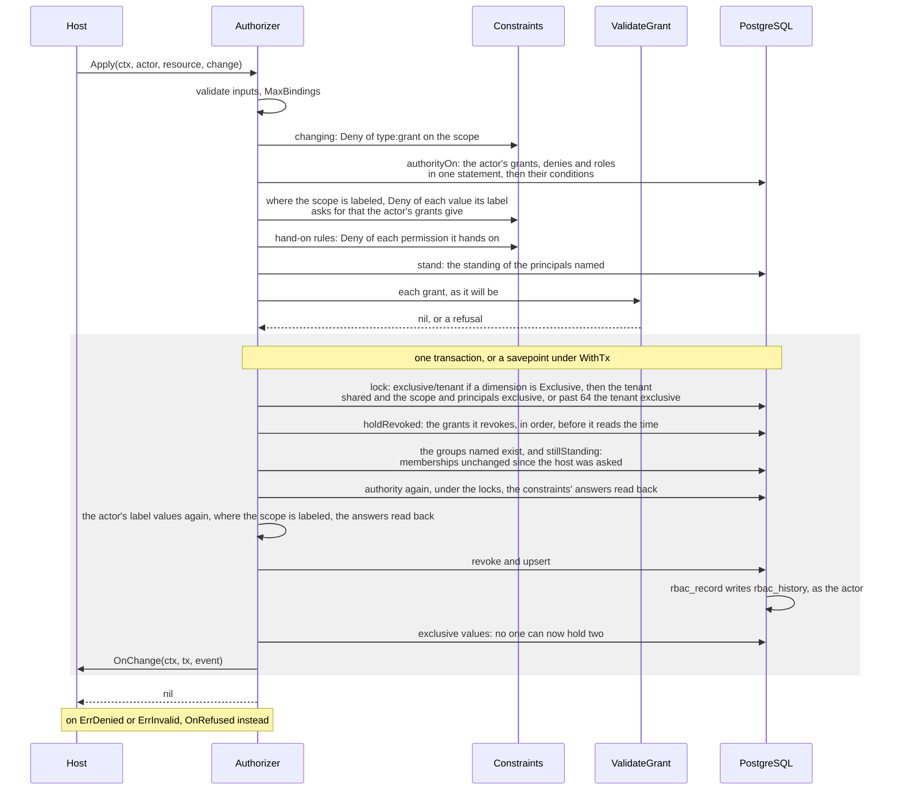

- **Who may change grants.** The actor needs `<type>:grant` on the scope. Through a role with
  `GrantableRoles`, it may grant only those roles, without holding them. Through any other role, it
  may grant a role only if it holds every permission of it, for every type the grant reaches.
  Either way, a limited grant permission can't mint a larger one.
- **Freezes.** A constraint removing `<type>:grant` from the actor on a scope, as a host freezes
  changes under a container, or a deny on its path doing so, stops `Apply` changing grants there,
  revoking them too.
  Every change an actor makes that takes access away there is stopped alike, whatever the actor's
  grants, as it needn't hold what it takes away: `SetRole` narrowing and `DeleteRole` deleting a
  role granted there (`changesStopped`, `scopesDenied`); `ChangeMembers` removing a member of a
  group holding access there, ending its place sooner, ending an activation made through the group
  there, or adding a member to a group a deny there names (`reachCheck.stopped`); and
  `DeleteGroup` with grants or eligibilities in force on the group's scope. Each is stopped by what
  it ends there, not by what the members hold after it, as `Apply` revoking a grant held twice is:
  a member leaving a group ends what the group and those it is in give it there, though another
  group gives it the same, but a place ending while another, from another source, keeps the member
  in the group as long leaves nothing (`placesLeft`), nor does one of an identity whose membership
  of the tenant has ended, which is in none of its groups, as `Members` lists them and checks count
  them, though `DeleteExpired` hasn't removed its places: read as stored, removing it was stopped
  for what gave it nothing. `DeleteGroup` counts none of them as a member the host keeps
  (`deletable`). Of the activations a removal ends, none is such an identity's: `Activate` ends one
  no later than its holder's membership, and `SetMemberships` ending one sooner cuts its
  activations short. `SetRole` and `DeleteRole` ask the
  constraints of no resource, and read the denies on the tenant as on the tenant, once for every type
  of scope the role's grants can be on (`changesStopped`, `changesDenied`), where a deny's condition
  reading the resource can't be evaluated and so denies (`handsOn`): stricter than `Apply` on a scope
  such a condition spares, as the grants span scopes no one reads, but never weaker, and only for a
  deny below the tenant, a label, or a constraint on what `SetRole` hands on where it gives more
  (`handedOnStopped`) is each scope read from the host. Whether a deny below the tenant binds the
  actor is read with its power to define roles (`roleRead`), and under the tenant's lock, where one
  did before the transaction, so are the denies on the paths of the scopes read from the host then,
  and the actor's label values are decided by what that read holds: read in up to four statements,
  `DeleteExpired`, which takes no lock, removed in between a place ended by its clock but not yet by
  the change's, of the group the actor's power came through, and the denies naming that group were
  read as binding it no longer, though at no moment did it hold the power and escape them. Where one
  binds the actor under the lock that none did before, the scopes weren't read with it, and the
  change is tried again (`ErrConflict`). `ChangeMembers` asks the
  constraints once about each type of scope a member only loses access on, of no resource
  (`freezes`), and reads the types whose power to change grants a deny binding the actor lists
  (`grantsDenied`); only for a scope of a type either names, or whose label can refuse the actor, is
  `Config.ResourceOf` asked, and then the constraints again about it and the denies on its path, in
  one read with the rest (`reachAuthority`). In its transaction the types are read again, in the
  read of its power over the members (`authoritiesIn`), and a type one binding the actor then names
  that none did refuses the change with `ErrConflict`.
  `DeleteGroup` reads the group alike: from the host only where labels are declared, or a
  constraint or such a deny may stop it changing grants on groups, so a condition reading the
  group's attributes reads what the host passes `Apply` there, and without `Config.ResourceOf`,
  where the group as stored isn't all of it, refused once its transaction finds anything granted on
  it (`storedWhole`); and where no such deny bound the actor before it, one that does under its
  locks has it tried again. Under its locks it reads the denies on the group's path, where one binding
  the actor may stop it, or where none did, whether one now does, in one read with the actor's power
  to manage groups and its label values, as a change to members reads what it acts by
  (`reachAuthority`): read apart, an actor moving in between from the group giving it that power to
  one such a deny exempts deleted a group, and revoked what was granted on it, though at no moment
  did it hold the one and escape the other, and a change to members took access away so. The
  host's own writes make no check of an actor, so no freeze stops them.
- **Until when.** What the actor holds only until a time, through an expiring grant, an activation,
  or a membership or place in a group that ends, it hands on only until then: `authorityOn` reads
  when each grant's holding ends, in the statement that reads the grants, and a grant may end no
  later than the latest holding of each permission it hands on. An eligibility, a custom role's
  definition and a place in a group that gains an eligibility need what they hand on held for good.
  An exemption from a deny lasts so too. With the grants, the statement reads the denies on the path
  that bind the actor's keys but exempt it only through keys whose paths end, places in groups or its
  membership, with the latest end of those paths, where the deny binds it past then (`lastingSQL`,
  `exemptUntilSQL`); one exempting it by its identity or a path that never ends, or binding it no
  longer than it exempts it, is read as now, as none. What such a deny removes, decided as `handsOn`
  decides one, the actor holds only until its exemption ends (`exemptUntil`): `holdsFor` and `under`
  hand it on no longer, `decidedAs` tells grants apart by that end, a scope such a deny is on the
  path of is decided apart from others (`proven`, `alike`), and `SetRole` giving more below the
  tenant reads them there as the denies binding the actor (`belowSQL`), though narrowing or
  deleting a role, which hands nothing on, asks the host nothing for them. Conditions are decided
  as of the change: a grant's is handed on with it, as what the actor holds under one it hands on
  only under the same, but a deny's can't be, so one holding only from a later time, as by reading
  `request.time`, bounds nothing handed on before then.
  Of the grants that count under a grant's condition, a decision reads only the role of each, how
  its principal carries it and whether it lasts until the grant ends, so `decidedAs` decides a grant
  until the soonest time at or after its end that the longest lasting of a kind of them ends, and
  grants ending between two such times share a decision: grants of one role to the actor's many
  groups, each ending at its own hour, are one kind, so a change granting a role to a thousand
  principals, each until its own hour, walks the roles it lists once. `heldFor` and `under` read how
  long the actor's grants give each permission, and the power to change grants, once for each
  question, whatever end it asks about, so each later end is one comparison.
- **Standing.** The host's answers rest on who is a member of what. `stand` fingerprints the
  memberships behind them, and `stillStanding` refuses the change with `ErrConflict` if any changed
  while the change waited for its locks.
- **Sources.** Grants, groups and members from a source in `Config.Sources` are the host's: only
  `Import`, `ImportGroups`, `ImportMembers` and the host's deletes change them.
- **Custom roles.** `SetRole` redefines a role in place for every grant of it, so it asks
  `ValidateGrant` about every grant and eligibility the new definition widens, before its
  transaction, and under the tenant's lock refuses with `ErrConflict` if those changed meanwhile.
  A grant widens by what it gives through its principal, as checks read it
  (`redefinition.widensTo`): one to the tenant's members of a privileged role, or to the public of
  a role not marked `Public`, gives nothing, and widens once the role gives it something, however
  the role changed, as narrowing it so that it is no longer privileged does. On each scope a grant
  that widens is on, the denies on its path that remove from the actor a permission the role will
  give refuse the change, as they would refuse `Apply` granting it there; on the others, only those
  removing its power to change grants there do. Scopes the actor's grants and the denies on their
  paths can't tell apart are decided once (`alike`), told apart by each grant's id and each deny's
  scope and id, whole: an id holds any text but NUL; and where a deny has a condition, by the
  resource, or a container's depth, as a deny's condition is evaluated within a budget for each
  scope of the path, which conditions stored past their bound can spend on a shorter path alone. A
  grant to the tenant's members of a privileged role is read there as one to a principal named one
  by one (`widenedTo.reaches`): a catalog change that has the role no longer be privileged gives
  them what it gives, what the redefinition added too, and asks no one. The constraints are decided
  so too where a grant widens, or a role listing it is granted, on that scope, as `Apply` asks them
  there, not only on the tenant, as `mayDefine` does: of each such scope as `Config.ResourceOf`
  gives it, once, whatever they would answer of no resource, as one that tells resources apart can
  answer nothing there, of the power to change grants there, which `changesStopped` asks only of no
  resource, and of what the role gives where the grant reaches, as `Apply` walks it: on a resource,
  for that resource's type alone, a `<type>:grant` of another type being a permission like any
  other there, which only the constraints are asked about, as `mayDefine` decides holding it
  (`handsOnAt`). Their answers are read back under the lock, where a scope it gives more on that
  they weren't asked about refuses it with `ErrConflict` (`handedOnStopped`, `handing`). Without
  `Config.ResourceOf`, a scope is asked about as stored where that is all of it (`resolves`), and
  otherwise of no resource, which stands for every such scope. A scope where a role listing it is
  granted counts only where its holders may grant it there: by a `<type>:grant` that role gives for
  that type, on scopes of the type the grant reaches, as nothing reaches the tenant but itself
  (`handingOn`). Each scope costs a `Config.ResourceOf` call and the walk `Apply` granting the role there
  makes, as `ValidateGrant` is asked about each grant it widens. A scope read as stored, as the host
  no longer has it, that the change comes to give more on while it waits refuses it with
  `ErrConflict`. A role's lists are compared sorted and without repeats (`canonical`), as one
  written around the package can hold them in any order, so renaming it is no redefinition, and
  setting a role, deny or eligibility again as it is stored changes nothing (`canonicalSQL`). A
  role lists in `GrantableRoles` only roles one of its `<type>:grant` permissions, on a type it is
  for, lets its holders grant (`lets`), so `holdsRole` checks the actor's power to grant each. It
  keeps a listing that already hands nothing on as stored, as once the role listed was narrowed, so
  renaming it needs only the power to define it.
- **Eligibilities.** `SetEligibility` lets a principal `Activate` a role for a while, perhaps
  only with approvers or a `requires` condition. An activation is a grant that ends no later than
  its eligibility expires, or its holder's membership or place in the group the eligibility names
  ends. It records the eligibility it was made through, by its principal's key
  (`activated_through`) and its id (`eligibility_id`), and rests on its holder reaching that
  principal: its own identity, through its membership, or a group, through the places in groups
  from it. Of the eligibilities that allow it, it is made through the one whose path from the
  holder lasts longest; of those lasting alike, one needing no approval, then its own, whose path
  every other rests on too, so leaving a group ends none its own eligibility would keep unless that
  needs an approval the group's doesn't; their requirements are evaluated cheapest first, as a
  check's conditions are, and the choice is made of those that hold. Between groups whose paths
  last alike it is by their approvers, requirements and keys, so leaving one can still end an
  activation another would keep. A change ending a membership or a place sooner, or removing it,
  holds it, in order, reads the activations of the identities it ends it for and holds them, before
  it reads the time it decides at, and once it has ended it, in a later statement, cuts each short
  to the latest end of the paths left to its principal, or ends it, whatever another eligibility
  would allow: worked out again from every eligibility the holder reaches, one whose requirement or
  approver it never met would count. Held, a change ending another of an activation's paths at
  once waits for it, and reads the paths it left: each reading them first would read the other's as
  left, and neither cut it. `Activate` holds the places it can rest on until it commits, in the
  statement that reads the keys it finds its subject eligible through, so the two wait for each
  other, and a place nested between them makes no one eligible. Setting the eligibility again or
  deleting it leaves its activations to their own ends, or to their holders leaving its group:
  where labels or a freeze can refuse it, `ChangeMembers` reads the activations of the members
  leaving made through the groups it reaches, each principal's once however many of its places end
  (`activatedBy`), and checks each one's scope as a revoke there, and `DeleteGroup` refuses a group
  they rest on. Both read them only once they hold the places they end (`restingIn`, and
  `unrested` once `holdGroups` holds them), so an activation `Activate` commits while one waits
  for them, through an eligibility deleted meanwhile, is read as one made before: `ChangeMembers`
  finds it in `stillReached`, which it hadn't checked, and is tried again (`ErrConflict`), and
  `DeleteGroup` refuses it. Read before them, it would be ended unchecked.
- **Approvals.** Approving decides access on the scope, so on a labeled one an approval counts
  only from an approver whose own label values satisfy the label: read before the transaction and
  again under its locks, with the constraints' answers on them sealed, as an actor's are, and
  with none of a request's attributes, as the one passed is the activator's: any read of
  `request.attributes` by a condition of them, a test of an attribute's presence included, fails,
  so a grant's gives nothing and a deny's applies. `SetEligibility` doesn't check the approvers it
  names, whose values, and their groups' members, change after it: `Activate` checks the one
  approving.
- **Activations stored before migration 0012** record what migrating found: the one eligibility
  for their role on their scope whose principal their holder reached then, or, where it reached
  several or none, nothing. The first change re-checking one that records nothing ends it, as which
  path it rested on can't be told; activating again until later records it. The package had no
  release before it, so only a developer's database holds them, and none lasts past
  `MaxActivation`.

## Lists and searches

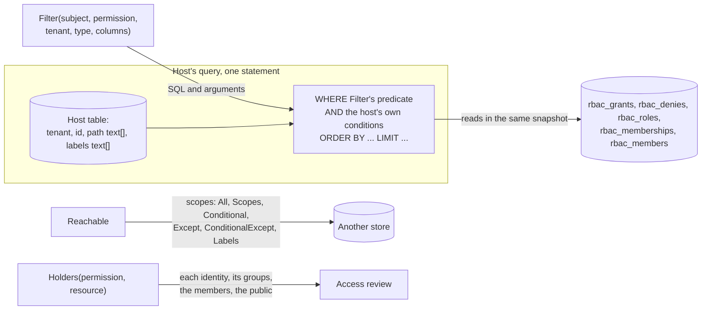

- **Filter** returns a condition for the host's own query, which reads the grants in the same
  statement as the rows, so sorting and pagination work and nothing changes between deciding and
  reading, for the query it was built for: build one for each. It never keeps a row Authorize would
  refuse. It keeps only the rows whose own key is of the listed type, as a grant on a container
  reaches every row under it, of any type, so one table can hold several. The planner has no
  statistics of a path's first key and counts a test of it alone as keeping one row in 200, which
  would turn a sorted page of a table of one type, whose condition no index serves, into a read and
  sort of the whole tenant. So the type picks the keys a row's denies are looked up by, which the
  planner counts alike whatever they are: a row of another type has none, so its lookup is unknown
  rather than false, and the row is left out. The subject's grants are matched through the path's
  GIN index, which merges the rows each finds, so its cost for each row grows with their number.
  Past a few on resources of the listed type, each row's own key is looked up in a hash of them, and
  past 128 on containers and the tenant, or past a few alongside those, each of its keys in one
  object of them all, so one with a grant on everything it created costs a row a few lookups; no
  index serves that, so the query reads every row of the tenant its other conditions keep. Denies
  are looked up so whatever their number: those on resources of the type by the row's own key, and
  those on containers and the tenant by each of its keys. Those naming the subject or its groups are
  read by those keys alone. Those naming the public or the tenant's members bind everyone, and any
  number of them can be on scopes of other types, which no index tells apart: while fewer than 16
  denies are on scopes of the types a list reads, it reads those by type, and otherwise finds the
  ones naming everyone by those keys, so a tenant with many of both has every list read every deny
  naming everyone. A row's label is tested by looking each of its values up, byte for byte, in
  objects the statement builds once of the values the subject's holding allows, and of each `AnyOf`
  dimension it holds some values of but not all, that dimension's values and those it holds, so a
  row costs a few comparisons for each of its values however many the dimensions declare, in a
  custom plan or a generic one: an array's containment or overlap would compare each with every
  value declared, and `= ANY` hashes only an array a plan holds as a constant. The planner counts
  each lookup as keeping a third of the rows, so a dimension held whole or not at all has no test of
  its own, which with many declared would have a sorted page planned to read every row.
- **Reachable** returns the same as scopes, for a host that keeps its resources elsewhere. They hold
  for resources of the listed type alone: a scope reaches everything under it, of any type, so a
  store holding several keeps to the type itself. Conditional grants and conditional denies come
  back apart, to check one by one.
- **Holders** lists who may do a permission on a resource, for an access review. That is each
  identity, through its own grants and its groups', with the tenant's members and the public as
  one holder each. It marks holders that hold only under a condition, or that a deny, a
  constraint or a label may refuse. It evaluates no condition, so it lists too many rather than
  too few: a conditional grant or deny marks its holder whatever the condition reads, the resource
  alone too, and a deny leaves out whom it binds only where it has no condition
  (`boundByDenies`). For a labeled resource it reads every identity's label values'
  grants and denies in one statement in the list's snapshot, and narrows that read once for all of
  them to the roles giving values (`valuesOfAll`), so each identity walks only its grants of those:
  narrowed for each, 1,000 holders, the tenant's members granted 300 roles of 1,000 other
  permissions, read every role again for each holder, 300 million entries, in seven seconds. It
  decides each one's values evaluating no condition either (`runs.unevaluated`): it keeps and marks
  a holder by its values a condition takes part in deciding, a grant's or a deny's, whatever the
  condition comes to (`listing`), so a conditional deny counts as one that can't be evaluated, and
  a conditional grant gives nothing beside them. Evaluated for each holder and set aside, a value
  granted to a group of 1,000 under a condition costing hundreds of steps took Holders a second,
  where granted under none it took 33 ms, to list the same.

## Labels and exclusive values

A label is mandatory access control above every grant. The host declares dimensions in
`Config.Labels`, with `Config.ResourceOf`, through which changes read the labels of the scopes they
reach, the tenant's and its groups' among them: `New` refuses labels without it. A subject holds a
dimension's values as permissions, `dimension:value`, which roles for the tenant alone give, granted
on it, and a labeled resource is allowed only to a subject whose values satisfy its label. A custom
role stored for another type too, as one defined before its dimension was declared can be, is read
as giving none of them (`current`), privileged and public as the whole role is, so no grant below
the tenant gives one, its grants count toward no exclusive dimension, and a check of a value and
`Permissions` decide it by the same grants.

- **Values are decided on the bare tenant.** Every check decides a label value or a power to release
  on the tenant with no attributes or label, whatever tenant resource it is passed, as `Holding`
  reads them for a labeled check, which can't know what tenant the host means. So a check of a value
  and a check of a label agree, and an actor hands one on only as it holds it. A condition of theirs
  can't read the tenant's attributes: any read of them fails, a test of one's presence included, so
  a grant's gives nothing and a deny's denies, rather than hold or lift for what the bare tenant
  lacks. A constraint deciding them by the tenant's state reads it itself, through its `q`.
- **A change decides each value once.** A change checking the labels of many scopes by one read of
  the actor's values, as one to the members of many groups, decides each value once in each phase,
  when a label first asks for it (`decidedBy`), and shares what the conditions it evaluated came to
  across them (`runs`), so a condition that doesn't read the action runs once for all of them. Each
  value is still decided on budgets of its own, which pay for every condition they read, whether
  they ran it or a value before them did, so it decides as a check of it alone would, and what one
  label asked for first never changes what another is decided by. `ChangeMembers` decides the
  groups' labels and those of the scopes its members gain or lose access on by one such read in
  each phase: before its transaction, the values `mayManageGroups` read with its power over the
  members, which `mayReach` shares with the reads of its power on the scopes; and under its locks,
  one read of its power over the members and on every scope it checks (`reachAuthority`), whose
  values decide them all, so it held every power it acts by and every value a label asks for at
  one moment. Read again with its power on the scopes, a value was decided twice in each phase, and
  a condition of it that doesn't read the action ran twice. Each walks only the read's grants
  of roles giving values or powers to release, and of each role only those, privileged and public
  as the whole role is, which the first decision narrows the read to, reading each role once
  (`labeling`): a holding decides by nothing else, so the actor's grants of other roles, however
  many or large, cost a label nothing. A check deciding a subject's values, as `Authorize` of a
  labeled resource, `Holding`, `Filter` and `Reachable` do, narrows its read so too, and `Holders`
  its one read of every identity's values, once for all of them, so each identity's decision walks
  that read as it is (`narrowed`).
- **Releasing and writing.** `ReleasePermission(dimension)`, held on the tenant, is the power to
  release data to a looser label in that dimension, so only a holder of it can downgrade data. A
  `Holding`'s `MayWrite` and `MayRelease` say whether data read under one label may be written, or
  released, under another.
- **Exclusive values are checked when they change.** A change that would let anyone hold two
  values of an Exclusive dimension is refused, after its writes and under its locks. `Conflicts`
  lists anyone left able to, as a catalog change can leave them. Which values an actor holds none
  of, and so can't hand on, a change reaching many scopes decides from each path's grants
  (`authorities`), reading each of its roles' permissions once for all of them. Where no dimension
  is exclusive, nothing is read.

## Transactions and locks

Changes take PostgreSQL advisory locks, named by the schema holding the tables, as every session
reaching them names it whatever its search_path, so two changes to the same rows run
one after the other, each taking its locks in one order. A name gives the schema and the tenant
each with its length, as either may hold `/`, so no two locks have one name (`lockName`). A lock's
key is the first 8 bytes of its name's SHA-256, computed in Go (`lockKey`), so the locks of two
tenants meet only where a name is found whose key is another's: some 2^64 hashes to match one
key, and 2^64/n to match any of n, which takes knowing their names. PostgreSQL's
`hashtextextended`, which keyed them before, can be inverted: a tenant's admin could name a group,
in a millisecond, whose lock was another tenant's own, and hold every change there back while
changing it. A lock no id names, a tenant's own, its exclusive values', its nesting's or
`Migrate`'s, takes its key as two int4 keys, which PostgreSQL holds apart from every bigint key,
as a scope's or a principal's lock takes: no id an actor chooses reaches one, however the hash
fares. The batch taking a change's locks reads the schema too, and names them by the schema the
process's last locks were taken in, taking each only where its statement finds the tables there:
unless each did, the change takes them all again by the schema the batch read first, a round trip
more (`takeLocks`), so a schema renamed while the batch waits leaves none of the later ones
untaken. The locks last until the transaction ends, so under `WithTx` two host transactions
changing the same scopes or principals in opposite orders can still deadlock, as can a change that
also writes rows it doesn't lock: PostgreSQL fails one, which matches `ErrConflict`.

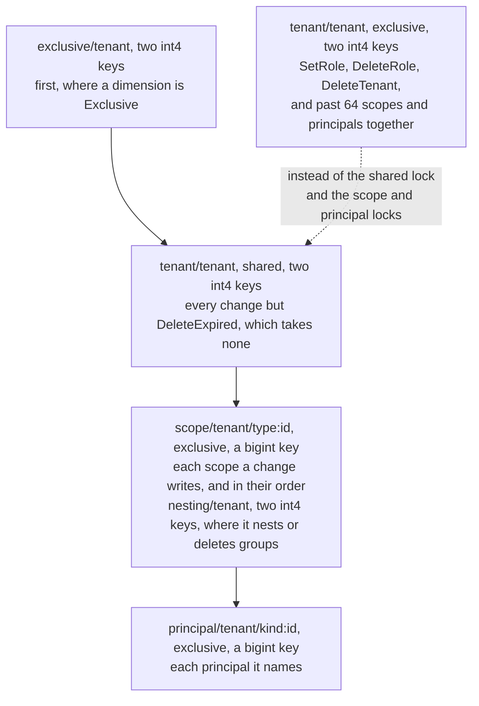

- **READ COMMITTED.** A change runs at READ COMMITTED, as its checks under the locks must read what
  committed before the locks were taken. Under `WithTx` the host's transaction must be at READ
  COMMITTED too, as must one `Migrate` is given.
- **One goroutine at a time on a transaction.** An Authorizer bound to a transaction or a
  connection, as `WithTx` and AsOf's read give and `New` returns on a `pgx.Tx` or a `*pgx.Conn`,
  runs every call on that one connection, which pgx doesn't make safe for concurrent use: calls on
  it from several goroutines at once can panic in pgx's watch of a context, fail as the connection
  busy, or race on what the connection keeps, as the map of its cache of prepared statements,
  whose concurrent use the runtime ends the process for. The package adds no guard, as pgx adds
  none: one that made overlapping calls take turns, or refused them, made a hook's call back in
  wait for what its own goroutine held, some for good, where pgx failed fast or ran it. A hook
  calls back in one call at a time, between a call's statements, as constraints and `ValidateGrant`
  are asked, or in a change's savepoint, as `OnChange` is. For an access review in parallel, a
  host runs several `AsOf` calls on a pool's Authorizer, each in a transaction of its own. New's
  Authorizer on a pool is safe for concurrent use as the pool is, and one on a host's own DB as
  that is.
- **A host's own DB.** One that is neither a pool, a connection nor a `pgx.Tx` begins with `Begin`,
  and its first statement sets the isolation a change or a read of one snapshot needs (`isolated`):
  another level first, then that one. A savepoint of a transaction under way, as a wrapper around
  the host's own gives, may set the level its transaction has but no other, so it refuses one of
  the two, and the call runs on the host's transaction, as under `WithTx`; setting the one level
  alone, a savepoint of a transaction at it passed for a transaction of its own, and `Migrate`
  bounded its waits there and left them so in the host's transaction.
- **Rows in one order.** Under its advisory locks, a change holds the rows it may wait for in one
  order of tables, each table's in its own order: eligibilities (by scope, principal and id), denies
  (by scope and id), memberships, places in groups (by group, principal and source), and grants (by
  scope, principal and id) last. `DeleteGroup` and `DeleteGroups` (`holdGroups`) hold eligibilities,
  denies, places and then grants with the activations resting on the places; `DeletePrincipal` the
  same, an identity's membership before its places; `DeleteScopes` eligibilities, denies and then
  grants; `SetMemberships` every membership it sets, places and then activations; `ChangeMembers`
  and `ImportMembers` the memberships they join with (`holdJoining`), the places they write
  (`restingIn`) and then the activations resting on those; `DeleteMembers` and `ImportGroups` places
  and then activations; `Activate` the places it can rest on, shared, and then its activation of the
  role; `Apply` the grants it revokes, and those it grants again until an end; `Import` those it
  grants again until an end; `DeleteRole` the role's eligibilities and then grants; and
  `SetEligibility`, `DeleteEligibility`, `SetDeny` and `DeleteDeny` the row they write. A membership
  is held only under its identity's lock, and by `DeleteExpired`, which waits on no row, so no two
  changes hold memberships and places in other orders; and a group's row only under the group's
  lock, which a change takes to write or delete the group, or a place in it, whose insert holds the
  group's key. `DeleteScopes` holds its scopes' locks and `DeletePrincipal` its principal's, so
  neither waits for the other, and both delete the principal's grants and eligibilities on those
  scopes: each locks them in the order of their scopes first, eligibilities before grants, so they
  don't deadlock. A revoke locks the grants it deletes in that order too, as a change ending places
  in groups ends activations among them without their scope's lock. `DeleteRole` removes a role's
  grants before its eligibilities, which it holds already, and holds the tenant's lock exclusive, so
  no change runs beside it but `DeleteExpired`, which waits on no row. A host transaction making
  several changes takes each one's rows in this order, but not all of them together: two that make
  the same changes in opposite orders can deadlock (above).
- **One snapshot for reads in several statements.** Explain, Reachable and Holders read in one
  REPEATABLE READ, READ ONLY transaction of their own on a pool, and AsOf in a REPEATABLE READ one
  it rolls back. Explain, Reachable and Holders read what label values are decided by in it, and
  decide them after it, as the constraints are asked outside it. Under `WithTx` they read on the
  host's transaction at its isolation, AsOf in a savepoint: at READ COMMITTED each statement reads
  a moment of its own, so a change committing between two can mix two states, and for AsOf, history
  of a time not yet final. Conflicts reads in one statement, the custom roles with their grants, as
  a check and `broadExcludes` read them, so it lists what one moment held under `WithTx` too, with
  JIT off for it (`withoutJIT`). A read that sets planner settings for its own statement alone
  (`planned`), as that, `Holders`' read of label values, a check's read of its subject's grants
  (`indexed`) and a change bounding a scope's conditions (`seeking`) do, sends it in one batch
  between a statement setting them, which keeps each one's value in a variable of the package's own,
  and one putting them back, so the server puts the host's back however the call ends once it has
  sent the batch: where the statement fails, nothing after it runs, and the rollback puts them back;
  and the batch is read to its end where the call's reading of its rows fails or panics, so the
  pool, or a host recovering in its transaction, has the connection back. Set and put back in
  statements of their own, under `WithTx` a `Holders` refused for its ctx once its read had run left
  the host's transaction JIT off, as did one whose panic the host recovered from, as no savepoint of
  the call's rolls them back. Nothing else runs on the session within one batch, so no read, of the
  schema's tables or another's, can change the variables in between. A read holding settings across
  several statements (`planning`), as `AsOf`'s and `History`'s do, keeps the host's in the call
  instead, as a read between them may be planned, which changes the variables.
- **One time for a call.** A call reads `Config.Now` once, where it first needs the time: every
  statement it makes compares expiry with it, and every condition reads it as `request.time`, so a
  grant or a membership ending as the call runs can't meet a deny, a condition or label values of a
  later moment. A change reads it again in its transaction, once it holds every lock it waits for,
  advisory and on rows, where it decides again by what committed before them: read before a wait, it
  would decide at a time the wait left behind, as by an actor's power that ended while it waited,
  and store a place, a membership or an activation already ended. So a change holds first what it
  may wait for, the activations it may cut short and the grants it revokes, the eligibility or the
  deny it sets too, and picks what is in force to hold by its reading before the transaction
  (`callClock.earlier`), which is no later, so what was in force then is all that is when it
  decides, and perhaps more: `Activate` holds the places it can rest on as of then, and keeps of the
  paths through them those lasting until the activation's end from the time it reads once it holds
  them, as walking there would, and holds its activation of the role, which a change ending places
  holds with every activation of the identities it ends them for. `SetMemberships` holds the places
  of the memberships that had ended as of then, not those of every membership with an end: the
  places of one ending in between it removes without waiting (NOWAIT), or is tried again. Where the
  host's clock goes back between the two readings, what was in force at the first can be less than
  at the second, and the change is tried again (`wentBack`): a removal reads the second whether or
  not it found anything to hold by the first. A write's own locks take again what the change holds,
  an upsert's the row it conflicts with too: `DeleteExpired` takes no lock, and holds what it
  deletes until its transaction ends, a host's under `WithTx`, so a change holds first what it
  writes that one may be deleting, as ended by its clock: `SetMemberships` every membership it sets,
  `Apply` and `Import` each grant they grant again until an end, and `DeleteRole` the role's grants
  and eligibilities. A grant for good no expiry deletes, and a group's row, which a place's insert
  holds for its key, is held only under the group's lock. In the tests, a statement holding rows or
  taking an advisory lock once a change has read its time panics, and so does a change whose session
  waited for a row then, whatever the statement, as another session's watch of each one's wait
  events sees (`watched`). As of a time, it is that time.
- **Races** PostgreSQL refuses, such as a serialization failure, a deadlock between host
  transactions, or a lock waited for past `lock_timeout`, as one a migration holds, match
  `ErrConflict`, still wrapping PostgreSQL's error: try again. Every exported call maps them, as it
  returns (`conflicting`) where it queries outside `begin`, which maps its own, wherever an error
  holds one, beside others too, as `errors.As` reads one, reading the tree, however many errors it
  holds, in the order `errors.Is` reads it, to the first race or `ErrConflict` (`conflicted`), so
  one refused before a change's transaction, as in the reads that decide a change first, which under
  `WithTx` run on the host's transaction itself and can deadlock with a migration, in a read, or in
  a hook's statement, whose error a call returns as it is, matches too. Under `WithTx` the host runs
  its transaction again from its start: a statement refused on it outside a savepoint aborts it, and
  a savepoint, rolled back to, frees nothing taken before it, which the race can be over. The signer
  `Export` and `Checkpoint.Sign` are given is a hook too. Wherever a call reads a hook's error, for
  a race, for `ErrInvalid` or `ErrDenied`, as it reads `ValidateGrant`'s answer and decides what
  `OnRefused` is told of, or for `ErrNotFound`, it reads the tree in the order `errors.Is` and
  `errors.As` read it, and once it has read and queued ten thousand or so of its errors
  (`remembering`), each it can compare once (`holds`): one whose tree holds itself, as a host's type
  can by mistake, comes round again, which they read forever, so a call passes over what it has read
  and returns, though the host's own `errors.Is` of what it returns can still read it forever. Not
  from the first error: remembering one compares it whole, and a value wrapping an error holds all
  that one wraps, so a tree nesting such values thousands deep would cost the square of its depth.
- **Migrating.** `Migrate` applies each pending migration in a transaction of its own, under an
  advisory lock on the schema that holds another replica's migration back, and records it as it
  commits: so a migration takes its locks in the order it names them, the tables before history,
  whatever was pending before it, and a failure leaves the database at the last migration recorded,
  where code from before it can run on, so each migration must leave the tables as that code can
  use them. A migration waits at most 100 ms for any lock on the tables, as it holds those it took
  meanwhile, and gives way: `Migrate` rolls it back and tries it again, up to 10 times. That wait
  ends before PostgreSQL's deadlock check, which alone cancels an autovacuum worker blocking a lock,
  once a wait passes `deadlock_timeout`: where an autovacuum worker holds one of the tables as a
  migration gives way, the next try first takes each such table's `SHARE UPDATE EXCLUSIVE` lock,
  waiting a second past `deadlock_timeout` (`outwaitVacuum`, from `pg_locks` and the vacuum and
  analysis progress views, which any role reads), and then the migration's own. That lock conflicts
  with none a check, list or change takes, so none waits behind it while the migration holds none of
  its own. Each table is locked in a savepoint of its own: where its wait ends, as for a vacuum to
  prevent wraparound, which PostgreSQL never cancels, the try rolls back to that savepoint and goes
  on without that table's lock, to the next table's wait, and each try after waits so again, some 20
  seconds more over the 10 tries for each such table with the default `deadlock_timeout`. A wait for
  another replica's migration is bounded by the session's `lock_timeout` alone, and not tried again.
  On a host's transaction `Migrate` applies them all in one savepoint, with neither the bound nor
  the tries, as rolling back to the savepoint frees nothing the host took before. The schema's lock
  is named and keyed as a tenant's own is (above), by the schema it migrates.

## History, export and AsOf

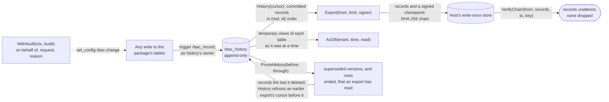

- **What a record holds.** Each holds the row as it was and as it became, when it took effect, the
  database role that wrote it, and the actor and call it was made through, with what the host
  attached. A change takes effect when its statement began, or its transaction where that began
  later, as in a procedure that commits as it goes, and an expiry when it expired, but never before
  the row's last record. A write that bypassed the package is recorded too, with no actor. The
  tables bound its row as the package bounds what it writes, but for the ids in a deny's or an
  eligibility's lists of principals, which they count in characters rather than bytes. A row of more
  than 1 MiB as jsonb, or a context of more than 1 MiB, fails its write, so no record is one
  `History` can't return. A row written before history was installed has one record from migrating,
  its baseline, dated when it was created, or at the epoch where that was before year 1 or at its
  first instant.
- **Commit records.** No other session sees a change before its transaction commits, which a host's
  transaction, or the package's own while `Config.OnChange` runs, can put off. So each transaction
  that changes the tables writes, as it commits, a record of when it did (entity and op `commit`, in
  no tenant, keyed by nothing), and AsOf counts each change from it, or from the change's own date
  where that is later. The constraint trigger `rbac_history_committed`, deferred to the commit, runs
  `rbac_record` as history's role for each record the transaction wrote, and the event of its last,
  by id, writes the commit record, dated by the clock then. A session can fire deferred triggers
  early with `SET CONSTRAINTS ... IMMEDIATE` and hold the transaction open: the commit record's own
  event fires inside the trigger that wrote it, a level deeper than at the commit, so there it
  defers the trigger again, by name, and writes a record dated -infinity, which no read counts from,
  whose event records the commit anew as it commits; AsOf counts from the latest. A cursor `WITH
  HOLD` the transaction declared, also in a procedure's or a `DO` block's later transaction, whose
  creation time is the block's, and an enabled deferrable trigger on a temporary table, would run
  the session's own code after the commit record as it commits, so a transaction with either is
  refused. The temporary-table check reads the catalog as the commit record is written, so it is a
  best-effort defense that assumes the README's roles: it holds against a session with no
  `TEMPORARY` privilege, which can make no temporary object, and is best-effort against one with it.
  The roles revoke `TEMPORARY` from `PUBLIC` and grant it only where needed; the application's role
  needs it only for `AsOf`, which makes temporary views. What runs after the commit record is the
  rest of the commit: the host's own deferred triggers and constraints of statements after its last
  change, the session's temporary tables dropped or emptied, about half a millisecond each at the
  default `temp_buffers` but seconds at a large one (emptying an `ON COMMIT DELETE ROWS` table scans
  the temporary buffers; 2,000 held a commit about 5.4 s at `temp_buffers = 4GB`, which
  `lock_timeout` doesn't bound), waiting for no lock past 100 ms, as another session can hold one of
  those tables, the wait for synchronous replication, and for a prepared transaction, everything
  until `COMMIT PREPARED`. A transaction that committed before `0027_commit_dates` has none, and its
  changes count from their own dates. `History` returns no commit record, but each record with its
  transaction's (`Record.CommittedAt`), which the chain covers as every other field; a prune deletes
  it with the last of its transaction's other records. What AsOf reads of a time is final once every
  transaction whose commit record is dated by then is seen by others.
- **History's order.** `History` reads records in transaction order, by the id each transaction
  takes at its first write, and only those of transactions older than every transaction still
  running, which have all ended. So a cursor never passes a record that commits later. That is
  not each row's order: a transaction that took its id first and changed a row after another
  committed a change to it is read first, though its change came after. A row's versions are in
  the order of their records' ids, in which they were written, as AsOf and PruneHistory read
  them, and a consumer replaying an export applies them so. Any transaction holding an id holds
  every read back, AsOf's too, whose views take one. It, `Export` and `PruneHistory` name history
  by its
  schema, as `AsOf` does, and their types by pg_catalog's, so a session's temporary table or type
  stands in for none of it. A schema the application's role made or can create in, first on its
  search_path, would: that role can do neither.
- **Generations.** A cursor names its generation: the database cluster, by its system and
  timeline, and the database and schema. Failing over or recovering to a point in time starts a
  new generation, which an export starts again from `Genesis`. A restore that starts none, as
  from a disk snapshot, keeps the generation: where it lost a cursor's last record, `History`
  refuses that cursor, and history is exported again from the start. Where it kept that record
  and lost what came after, nothing in the database tells it from recovering from a crash, so a
  restore that should start a generation is a recovery to a point in time.
- **No record goes from under a cursor.** A prune records, for each of its transactions that
  deleted any, the last record it deleted in `History`'s order, and `History` refuses the cursor
  of an export that began before the prune where it is before that record, in the statement that
  checks the cursor and again in the one that reads after it, as a prune can commit between them:
  an export further behind than the cursor a prune went through would otherwise read on past what
  it deleted, and chain the rest as all history held. An export that began after the prune reads
  history as it left it, and stands where an earlier one could: its cursor's `Horizon`, the oldest
  transaction running as its first read from the start began, tells them apart, as a prune of an
  earlier transaction had ended by then. A read from the start reads nothing while a prune it sees
  is of a transaction no older than the oldest running, which it would count as one since.
  It counts the prunes of every transaction from the cursor's on, or from its horizon where that is
  later: a prune deletes only records of earlier transactions, so no earlier one can have deleted
  past the cursor. It counts them by transaction, not by where each prune's record stands, as the
  trigger below lets a delete through for any prune its transaction records, whatever id history's
  owner gives the record. History's index of prunes by the last record each deleted
  (`rbac_history_prune_lasts`) finds the first that reached past a cursor, in an order no scan of
  history's rows gives without reading them all, and tests its transaction among its own entries.
  Of the prunes since an export began, it reads only those that refuse it, however many went
  through its cursor as it caught up from the start or fell behind, each of which, found by where
  it was recorded, was read from history's rows. An export from the start also passes over, among
  the index's entries, the prunes from before it began that reached past its cursor, until it reads
  past them. Both statements run with sorting off (`unsorted`), so that index's order is the only
  plan: where history's statistics hold no prune, as until an analysis samples one, the planner
  counts the prunes as none, and read every one since the cursor by transaction
  (`rbac_history_prunes`) to sort them, in each read and each window of a prune. A test of the
  transaction no index serves leaves that read, as that index holds every prune. A delete from
  history, which only a role with the rights of history's owner gets past the append-only trigger,
  is refused as its transaction commits (`rbac_history_pruned`) unless a prune that transaction
  records reaches the record, by the last it deleted or, for a prune recorded before 0020, the
  cursor it went through, and the record is of an earlier transaction.
- **The export chain.** `Export` hashes each record onto the last checkpoint with SHA-256 and signs
  the checkpoint with the host's `crypto.Signer`: ECDSA on P-256, P-384 or P-521, Ed25519, or RSA
  of at least 3072 bits, each verified with the Go standard library. `VerifyChain` checks a run of
  records between two checkpoints.
- **AsOf** stands temporary views of history in for the tables, in a transaction it rolls back,
  so every check, list and search answers as it would have at a past time, with the catalog and
  the label dimensions as they are now. Making the views takes a transaction id, which holds every
  export in the cluster back while the read runs. Every statement is planned for its arguments and
  runs without JIT, which such plans over history cost past `jit_above_cost` for any subject. It
  takes a time from PostgreSQL's earliest to 9999-12-30, to the microsecond, rounded down, as pgx
  sends it, and a later one as another.
  Each statement reads history by the rows it names, through
  history's indexes, as a search the custom roles its grants name, by their ids, and its principals'
  grants by principal and type, which history's index of a principal's versions holds beside the
  scope, as a check seeks them on its resource's path. A version counts by a time from its date, or
  its transaction's commit record where that is later, looked up by its transaction in history's
  index of commit records for every version, as `History` reads `CommittedAt`, so what a time reads
  turns on nothing an export leaves out. Commit records held the oldest transaction then running,
  by which AsOf counted every older one's changes as committed without looking them up, as many as
  two fifths fewer pages for a check once a later transaction had committed, and a seventh fewer for
  a prune; but no export held that bound, and history's owner could insert a commit record bounding
  every transaction, which had a revoke held open read as in force while every record `History`
  returns read the same. Each record holds the cluster (`system_identifier`, a bigint the indexes
  of an entity's versions and of commit records hold beside each) that wrote it, and a commit
  record dates only versions of its own cluster: a logical dump restored into another cluster
  carries commit records whose xids restarted there, so one's txid, colliding with a new
  transaction's, would date a restored change by that transaction's commit. A restored version
  matches its own cluster's commit record, so it keeps its dates; one of a cluster whose commit
  records are gone, or written before `0027_commit_dates` (null cluster), counts from its own date.
  `History` tells generations apart the same way. A `pg_upgrade` gives the cluster a new identifier
  and keeps its xids, so versions from before it match their own commit records as before. A
  failover to a physical replica keeps both the identifier and the xids, as does a recovery to a
  point in time, whose new timeline numbers again only xids of what it lost, which history lost
  too: rows of a lost timeline brought back into it would match its new transactions' commit
  records. The trigger stamps a record from a setting of its transaction, read from the server
  once, which a session can set as well, so the commit record reads the server's identifier and
  refuses the commit (SQLSTATE 42501) where any record its transaction wrote names another: a
  version so stamped would count from its own date, before the commit. A restored record of
  another cluster, of a txid this cluster has since given the transaction, an earlier transaction
  wrote, which the record's `xmin` tells, so the transaction commits. Every comparison of two
  versions' transactions, and of a version's with the reading transaction's, is of txid and cluster
  both, as the restored txid is another transaction's. `History` returns the stamp
  (`Record.Cluster`), which the chain hashes as it does every field. Each version a view finds is
  its row's last where no later one, by id, counts by then, a test of each on its own, by its key in
  history's index of an entity's versions, which orders a row's versions by date and those of one
  date by id, latest first: since commits are recorded no version is dated before the one written
  before it, so the test reads the row's latest version dated by then after it, and only where that
  one doesn't count, its transaction committed later, reads on from the version in that order until
  the first that counts, each version between two counted read once, whatever their dates; a read on
  from the version alone, against the index's order, read the page before the version's, of another
  row, wherever a row's last was first on its page. One written before reads the row's versions
  dated by then from the latest, as a release before 0006 could date a version before one written
  earlier. A few pages for each version, however stale history's statistics. That index ordered
  versions of one date by their places, so versions dated alike, as every write of a `DO` block is,
  each read every one before it. As a join, by statistics from before most of history was written,
  as autovacuum leaves them until a tenth of it is new, it read every version of the entity in the
  tenant for each version found, the key only a filter, so a check took seconds; a read of thousands
  of rows costs more than such a join planned by fresh statistics, which reads their versions
  together. That index holds the versions of grants, eligibilities and places in groups only for a
  read that names their key, as PostgreSQL proves a partial index's predicate from a query's
  conditions, and history's index of scopes holds them only for one that names a scope, so a read of
  them by their principal, scope, role or group seeks them in the index leading to it: by statistics
  that counted the tenant's rows of them as a few, a plan read every one in the tenant through
  either instead. `Holders` looks each identity's membership of the tenant up on its own, by its
  key, which the view of memberships gives as the principal: joined to a group's members, or looked
  up by the principal history copies beside the entity, it read, by such statistics, every
  membership in the tenant again for each member. The view of custom roles takes each one's newest
  version, testing none for a later one, so `Grantable`, which can offer any, reads each version
  once.
- **PruneHistory** deletes only what an export has read and later versions supersede. It keeps
  each row's last version counted by its time, as AsOf counts it, so AsOf answers as before for any
  later time, and refuses an earlier one; of a row whose last version by then ended it, it deletes
  every version, the end last; and a transaction's commit record once no other record of the
  transaction stays. Each version is tested for a later one counted by then as AsOf tests it, by
  its key and id. It reads history `MaxPrune` records at a time, each in a transaction of
  its own, so none holds exports back for long however long history is, and each planned for its
  arguments: the plan cache gave a connection one plan for every window, and planned a window twice
  once history's statistics changed. Each that deleted records
  is recorded in history, in the statement that deletes and dated when it began, with the last
  record it deleted, and AsOf finds the latest prune's time by history's index of each entity's
  keys, as a prune finds where the last of its time and cursor stopped, each in that index's order
  with sorting off, so neither reads every prune where the statistics count none. With several
  exports, it prunes through the cursor of the one furthest behind.

## Database roles

The application's database role must not be able to rewrite history, so the schema is set up with
three roles, and that role is no superuser and holds no role with a superuser's power or a way to
it: not `pg_write_all_data` or `pg_create_subscription`, through which it could write history, nor
`pg_execute_server_program`, `pg_write_server_files` or `pg_read_server_files`, which run programs
and write and read files as the server; before PostgreSQL 16 it has no `CREATEROLE`, which makes it
a member of any role but a superuser; it has no `REPLICATION` attribute, which reads every data
file, nor `SET` or `ALTER SYSTEM` on a parameter only a superuser may set. The README's
[History](../README.md#history) section has the exact grants.

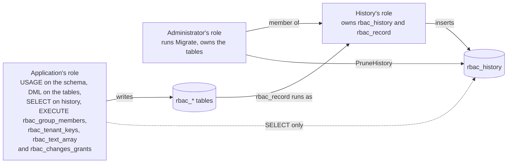

## Bounds

Every input that could grow without limit is bounded, so no call's cost depends on what a tenant
chose to store beyond these, but for the groups a subject is in through others (below) and for the
lists, which read what they list: `Filter` reads the subject's grants on the scopes that can reach
the listed type and the denies on them, and costs each row a few lookups among them however many
there are; and for the changes that check, once each, every scope what they change has access on:
`ChangeMembers` every scope the groups whose members change have access on, approve eligibilities on
or are named or exempt in a deny on, and `SetRole` changing what a role gives, and `DeleteRole`,
every scope it is granted on; and for the denies binding the actor of `ChangeMembers` or
`DeleteGroup` that remove a power to change grants, which they read wherever in the tenant they are,
as a deny on the path of a scope of a type one lists can stop them taking access away there, through
an index of those alone, so no other deny naming the actor, its groups, the tenant's members or the
public costs them anything; and for `ImportMembers`, which asks `ValidateGrant` once for each
member it adds and each grant or eligibility that member gains. The tables hold rows within the same
bounds, but for the ids in a deny's principals and exemptions and an eligibility's approvers: a
check can count an array element's bytes only with a function of the package's own, which every role
writing the table would need `EXECUTE` on, so the tables count those in characters, to `MaxID`, and
a role that writes around the package can store them at up to four times as many bytes. History
refuses a row of more than 1 MiB as jsonb all the same.

| Bound | Value | What it limits |
|---|---|---|
| `MaxID` | 512 bytes | A tenant's, scope's or principal's id. |
| `MaxBindings` | 1,000 | Bindings in one `Apply`, and the grants, memberships, groups or members one `Import`, `DeleteGrants`, `SetMemberships`, `ImportGroups`, `DeleteGroups`, `ImportMembers`, `ChangeMembers` or `DeleteMembers` takes, and the grants and eligibilities the members one `ChangeMembers` adds gain, each member's counted apart, by its principal, as `ValidateGrant` is asked about each, but no more than one place alone gains, whatever its group and those it is in hold. The host's own `ImportMembers` is asked about each with no such bound. |
| `MaxGrantsPerRole` | 20 | Grants in force of one role to one principal on one scope, differing by source, expiry or condition. Those from each source the host owns count apart. |
| `MaxDenies`, `MaxDenyEntries` | 100, 256 | Denies on a scope, and the principals, exemptions or permissions one names. A check, a list and a change's read of its actor's authority look each principal and exemption a deny names up in objects of the keys their subject is bound and exempted by, built once for the statement, so a deny costs them about its own length however many groups the subject is in; a check of a permission passes over a deny of another before looking any up, but on the tenant where it decides label values too, which every deny binding its subject there decides. `Holders` of a labeled resource indexes once the keys that the denies on the tenant of a label value or a power to release name and exempt, and looks each holder's own keys up in them, so such a deny costs the list its length once however many holders it binds, and one of any other permission is matched to none: compared with each holder's keys, 100 denies of another permission, each naming 256 of 4,000 holders, took a second and a half. |
| `MaxCustomRoles`, `MaxRoleEntries`, `MaxGrantableRoles` | 300, 1,000, 64 | Custom roles in a tenant, the permissions one gives and the types it is for, and roles one lists in `GrantableRoles`. |
| `MaxApprovers`, `MaxActivation` | 16, 366 days | An eligibility's approvers, and its longest activation. |
| `MaxGroupDepth` | 8 | How deeply groups nest. |
| `MaxPlacesInGroup` | 20 | Places in force of one principal in one group, each from another source. Those from each source the host owns count apart. |
| `MaxGroupsOfPrincipal` | 1,000 | Groups one principal, an identity or a group, is in directly, by places in force. Those from each source the host owns count apart. A check reads every group its subject is in, and every group those are in, `MaxGroupDepth` deep, which this bounds only level by level (below). |
| `MaxExpression` | 2,048 bytes | A condition's or requirement's expression. Its cost is bounded too. |
| Time zones a process keeps | 1,024 | The zones conditions read times in, each loaded once, and the names found to name none, as requests can name a new one each time. Past it, one kept is dropped at random. |
| A hook's copy | `2 × 80,000` units, as a check converts | What a constraint is given of the subject's or the resource's attributes, ancestors or label, and `ValidateGrant` of the actor's, each made once for a call. Past it the hook can't be asked, and the call is refused. |
| What a check reads together | 80,000 units: hundreds of comparisons with literals, a hundred of an attribute with the subject's id, or three of the longest conditions that read a list or loop | The distinct conditions of an identity's conditional grants on a scope; of a scope's conditional grants to groups, the tenant's members and the public; each the tenant's and those from each source the host owns apart; of a scope's conditional denies; and the requirements of groups' eligibilities for a role on a scope. Each counts compiling it, 8 a byte, and the most evaluating it can cost, at most 10,000. On the tenant, one reading the action counts once for each label value it gives or denies. A check may spend this for each on each scope of its path. A change adding to one reads only its conditional grants or requirements, by indexes of those alone, however many unconditional grants or other eligibilities the scope holds. |
| `MaxConditionBytes` | 32 KiB | The conditions one `Apply` or `Import` carries, each distinct one counted once. |
| `MaxName`, `MaxDescription`, `MaxNote` | 128, 2,048, 2,048 characters | Names, titles and group ids, descriptions, and notes and justifications. |
| `MaxRequest` | 256 characters | A request id in `Audit`. |
| `MaxHistory`, `MaxHistoryBytes`, `MaxPrune` | 10,000, 64 MiB, 10,000 | Records read by one `History` call, the bytes of their rows' JSON and their text past the first, and records deleted by one prune. |

`MaxGroupsOfPrincipal` and `MaxGroupDepth` bound the groups a subject reaches only level by level. A
check reads every group its subject is in, and every group those are in, each once, so an identity
in 300 groups, each in 300 others, is within every bound, and each of its checks reads 90,300
groups, for over half a second: only the tenant's groups bound how many. The denies on its path cost
it no more for them: each key a deny names is looked up among the subject's, where an overlap of
arrays would compare it with every one of the 90,300. Bounding the groups reached would have each
change nesting a group read, for every identity under it, every other group that identity is in,
under the lock that serializes nesting in the tenant: nesting a group of 20,000 identities, each in
about 50 groups, would read a million rows, for seconds, while every other nesting in the tenant
waits. Keeping nesting narrow is the host's, and the group managers'.
