# Architecture

How the package is put together: what it stores, how a check, a change and a list each run, how
groups, labels and policies combine, and how history is kept. The [README](../README.md) is the
guide to using it; this is the map of how it works, for reviewers and contributors. Each diagram
names the functions and tables it shows, so it can be checked against the code.

- [Context](#context)
- [Inside the package](#inside-the-package)
- [Data model](#data-model)
- [Principals, groups and keys](#principals-groups-and-keys)
- [Resources, scopes and paths](#resources-scopes-and-paths)
- [A check](#a-check)
- [A change](#a-change)
- [Lists and searches](#lists-and-searches)
- [Labels and exclusive values](#labels-and-exclusive-values)
- [Transactions and locks](#transactions-and-locks)
- [History, export and AsOf](#history-export-and-asof)
- [Database roles](#database-roles)
- [Bounds](#bounds)

## Context

The package is a Go library that a host application links. It keeps everything in PostgreSQL, in
tables prefixed `rbac_` in one schema, and asks the host only through the hooks in `Config` and
the `crypto.Signer` an export is given. It runs no server and holds no state between calls but
compiled conditions.

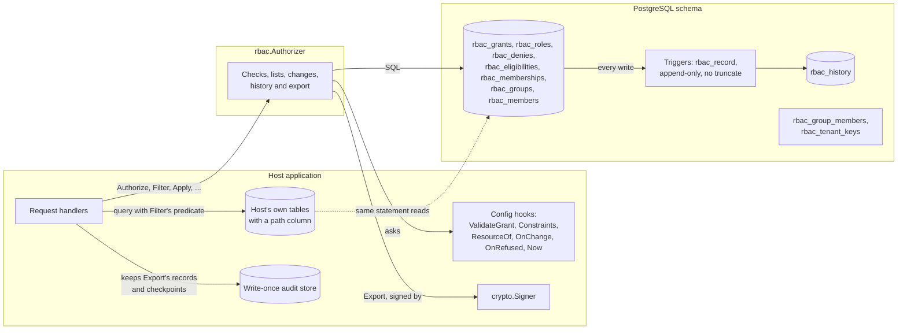

- **One database, one transaction.** A change runs in a transaction of its own, or under
  `WithTx` in a savepoint of the host's, so the host can create a resource and its creator's grant
  together.
- **The host owns identity and resources.** It says who a subject is (`Subject`) and what a
  resource is, with its ancestors and attributes (`Resource`). The package stores only grants,
  eligibilities, roles, denies, memberships and groups, and their history, keyed by the ids the
  host gives.
- **The host decides who may hold what.** `ValidateGrant` is asked about every grant and
  eligibility a change makes, and every place in a group, which gives what the group holds.
  `Constraints` remove permissions above anything a tenant grants. The host's own writes,
  `Import`, `ImportGroups`, `ImportMembers`, `SetMemberships` and the host's deletes, skip the
  checks made of an actor, but `Import` and `ImportMembers` still ask `ValidateGrant` about what
  they give.

## Inside the package

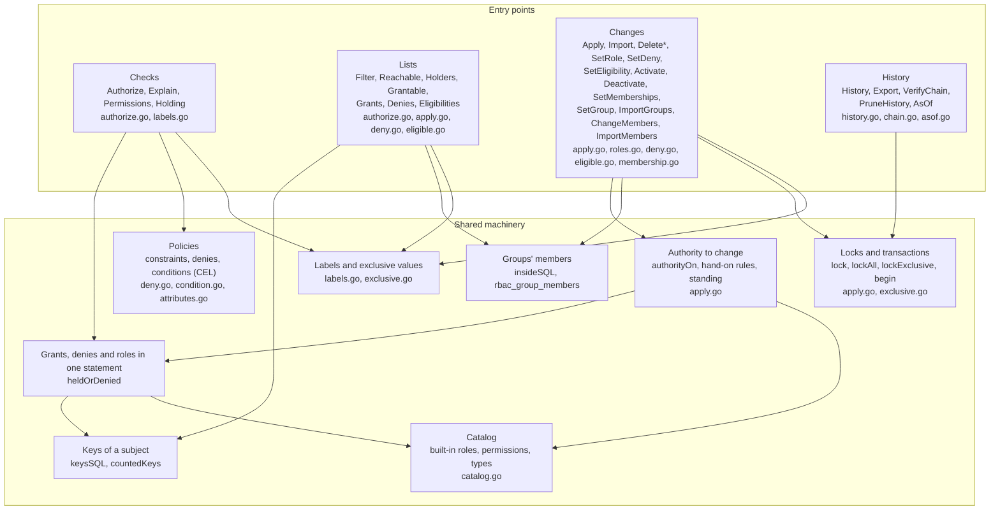

## Data model

Every row is a tenant's, by its `tenant` column: nothing is shared between tenants, and a tenant
is deleted with `DeleteTenant`. A scope is `type:id`, as `scope_type` and `scope_id`, with the
generated column `scope`. A principal is `kind:id`, as `principal_kind` and `principal_id`, with
the generated column `principal`.

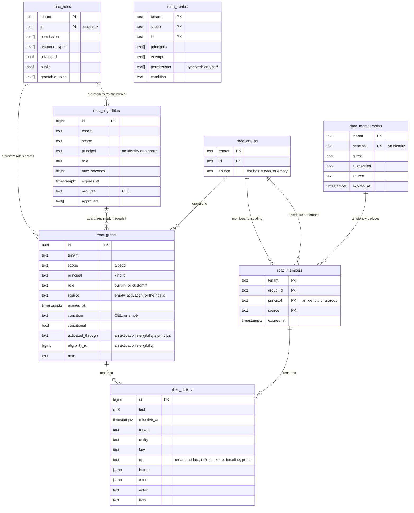

- **Built-in roles are not stored.** They are the host's `Config.Catalog`, so a deploy changes
  them for every tenant at once. Custom roles are a tenant's own, prefixed `custom.`, and give
  only permissions and types the catalog has.
- **A grant is one role to one principal on one scope**, from one source, until one time, under
  one condition. The key index `rbac_grants_key` holds what a check reads, so a check's read of
  grants is an index-only scan. The indexes by scope and by principal lead to both too and hold the
  same, so a connection's cached statement, once PostgreSQL plans it generically by the tables'
  averages, still reads only the subject's grants on the path, from the index alone, whichever
  index it picks.
- **A read of a list of keys reads each key's rows on its own** (`byKey`), as of a list's scopes
  or principals, of the denies on a check's path, of `Activate`'s eligibilities and of the rows
  `DeleteScopes`, `DeletePrincipal` and `DeleteGroups` remove, and so does a walk through nested
  groups: a generic plan costs `= ANY` of a list as ten seeks, and a read of the tenant by an index
  on it alone as an average tenant's few rows, and would read every row of a large tenant. The rows
  a removal locks in order it then deletes by key, never matched to the tenant's in a semi-join,
  which such a plan runs by reading every one. The eligibilities a group approves and the
  denies that name or exempt it, which a change to its members and `DeleteGroup`'s check read,
  those an identity or group leaving the tenant is taken out of, and the denies naming a list's
  subject or its groups, which `Filter` and `Reachable` read, are found through GIN indexes on
  those arrays of keys, each key prefixed by its tenant (`rbac_tenant_keys`), so neither the
  tenant's other rows nor another tenant's group of the same id are read.
- **Activations are grants** from the source `activation` (`SourceActivation`), made by
  `Activate` from an eligibility, which they record, and ended by their expiry, `Deactivate`, or a
  change ending the membership or a place in a group on their holder's paths to that eligibility's
  principal sooner.
- **Every write is recorded.** Each table above but `rbac_history` has the trigger
  `rbac_record`, which writes the change into `rbac_history`. Nothing updates or truncates that
  table, and only `PruneHistory`, as a role with the rights of its owner, deletes from it.

## Principals, groups and keys

A check counts what the subject's principals hold. They are found in the same statement as the
grants (`keysSQL`), up from the identity: its membership of the tenant, the groups it is in, and
the groups those are in, each counted once, as deep as they nest, which changes keep to
`MaxGroupDepth`.

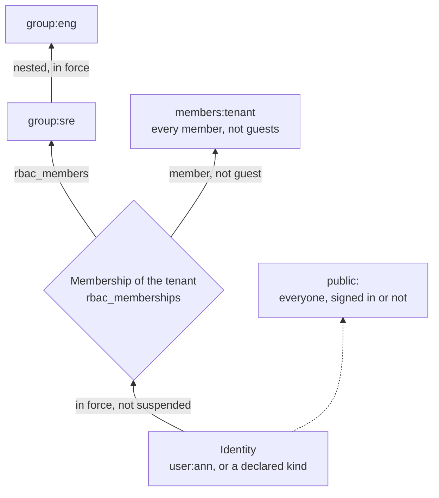

| Key | Counts for | Notes |
|---|---|---|
| `user:ann` | Its own grants | Only while it is a member or guest of the tenant, not suspended. |
| `group:sre` and the groups above it | The group's grants | Through each place in force, while the identity's membership is not suspended. |
| `members:<tenant>` | Grants to every member | Not to guests. Never a privileged role, nor one that changes access. |
| `public:` | Grants to everyone | Only roles marked `Public`, never a privileged one nor one that changes access. The anonymous subject holds these alone. |

- **Denies bind more widely than grants give.** A deny binds an identity through its groups and
  the tenant's members even while its membership is suspended, so suspending someone never lifts
  a deny (`bound`). A deny's exemptions are matched against every key the subject is in, the
  tenant's members too where a check of a permission that changes access counts none of their
  grants, and the identity's own (`exempted`).
- **Changing a group's members is granting.** Adding an identity to a group gives it what the
  group holds, so `ChangeMembers` needs the authority to grant all of it, and the host's
  `ValidateGrant` is asked as for a grant. The same holds for nesting one group in another, and a
  change that adds a member and nests its group asks about the member against every group it
  will be in.
- **Expanding down** from groups to their identities, for lists and changes, is `insideSQL`. It
  finds nested groups in the statement and their identities through `rbac_group_members`, which
  plans its query for the groups reached, so a small group's members are read alone however large
  the tenant's other groups.

## Resources, scopes and paths

A `Resource` is a tenant, a type and an id, with its ancestors: the containers it is in, nearest
first, of the types in `Config.ContainerTypes`. Its path is its own key, then its ancestors', then
the tenant's. A grant or deny on any scope of the path reaches it.

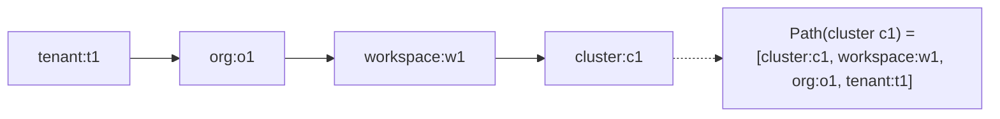

- **The host passes the ancestors** on every call, read from where it stores them. The package
  never looks a resource up for a check, so a check costs one statement, and more only where it
  needs its grants' conditions or the subject's label values. `ResourceOf` is asked only
  when a change needs a scope's own ancestors, labels or attributes.
- **For lists, the host stores the path** in a `text[]` column with a GIN index, and `Filter`
  matches it.

## A check

`Authorize` answers whether a subject may do one permission on one resource. It reads in one
statement, apart from the conditions of conditional grants, read only when no unconditional grant
allows, and the subject's label values, and refuses unless something allows.

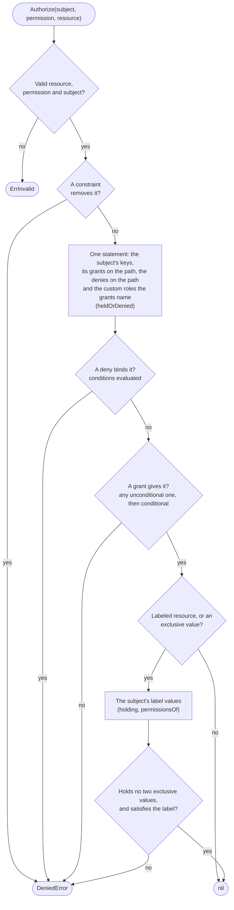

The layers, in the order a check applies them:

| Layer | Who sets it | Effect |
|---|---|---|
| Constraints | The host, in `Config.Constraints` | Removes a permission above every grant and deny. A tenant can't change it. |
| Denies | A tenant, with `SetDeny`, on a scope | Removes a permission from principals on the scope and under it, unless exempt. No deny removes `<type>:deny`. |
| Grants | A tenant, with `Apply`, on a scope | Gives a role's permissions on the scope and under it, perhaps under a condition. |
| Exclusive values | The host marks a dimension `Exclusive` | A subject able to hold two values of one holds none. |
| Labels | The host declares dimensions; tenants grant values | A labeled resource is allowed only to a subject whose values satisfy its label. |

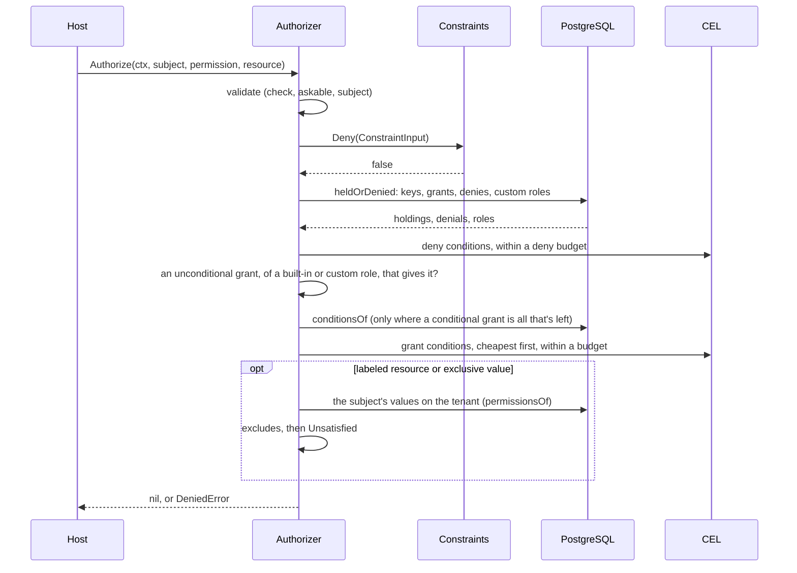

- **Explain** decides the same way and says why: every grant that allows, or the deny, constraint
  or label that refused, a label's or an exclusive value's dimension in `Decision.Label`. It reads
  the subject's keys, grants and denies in one snapshot, and its label values after it.
- **Permissions** lists everything a subject may do on a resource, deciding each as Authorize
  would.
- **Conditions** are CEL over `subject`, `resource`, `request` and `action`, typed by
  `Config.Attributes`. Each is compiled once, bounded in cost, and fails closed: a condition that
  errors gives nothing, and a deny's that errors denies. Each runs within the most evaluating it
  can cost, which its literals and types bound. What a check reads together is bounded where it is
  stored, for each scope: an identity's conditional grants, the conditional grants to groups, the
  tenant's members and the public, each the tenant's and those from each source the host owns
  apart, the conditional denies, and the requirements of groups' eligibilities for a role, and a
  change adding a condition past one is refused as invalid. A check's budget is that for each
  scope on its path, so it evaluates every condition it reads, and no grant made beside another
  changes what that one decides. Conditions stored before there were bounds may be past one, and
  so may those another version of CEL bounds: each process bounds a stored condition again by what
  the CEL it is built with makes of it, its macros and types, so an upgrade can bound one more.
  `TestStoredConditionsKeepTheirBounds` pins the bounds of conditions of common shapes, so that one an
  upgrade moves shows in review. A change adding no condition to them isn't refused, and a check
  evaluates them cheapest first within its budget.

## A change

`Apply` grants and revokes on one scope as an actor. Every change an actor makes follows the same
shape: it is decided once before its transaction, so `ValidateGrant`, the constraints and
`ResourceOf` run outside it, then again under its locks. The locks hold what the change writes, but
not what its actor's access rests on: the actor's grants, its membership and places in groups, and
those groups' grants. So two changes that each take away what the other's actor acts by can both
commit, a write skew: a manager removing another from the group that lets it change members, while
that one removes the first from theirs, both succeed, though either after the other is refused, and
no one is left to change members. Such a race grants only what each change's actor could grant
when it was decided, but more can stand at once than one after the other would leave: two changes
that each also grant, as adding a member while removing the other manager, leave both grants, where
the second, made after the first, is refused. It never lets in anyone an actor couldn't have let
in, but can take more away, as locking the tenant's admins out. The host undoes it with its own
writes, as `ImportMembers`, `Import` or `SetMemberships`, which no actor's access decides. Locking
what each actor acts by would close it, at the price of taking, for every change, a lock for each
group the actor acts through, which past 64 would lock the whole tenant for every change by an
actor in that many.

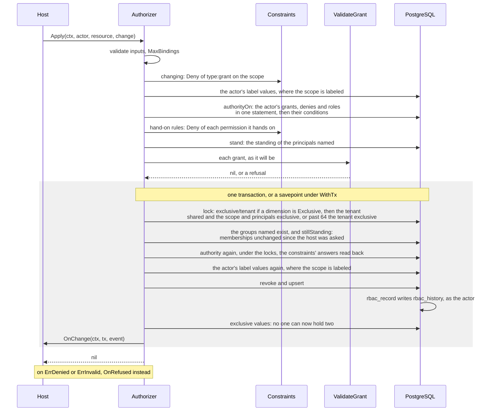

- **Who may change grants.** The actor needs `<type>:grant` on the scope. Through a role with
  `GrantableRoles`, it may grant only those roles, without holding them. Through any other role, it
  may grant a role only if it holds every permission of it, for every type the grant reaches.
  Either way, a limited grant permission can't mint a larger one.
- **Until when.** What the actor holds only until a time, through an expiring grant, an activation,
  or a membership or place in a group that ends, it hands on only until then: `authorityOn` reads
  when each grant's holding ends, in the statement that reads the grants, and a grant may end no
  later than the latest holding of each permission it hands on. An eligibility, a custom role's
  definition and a place in a group that gains an eligibility need what they hand on held for good.
- **Standing.** The host's answers rest on who is a member of what. `stand` fingerprints the
  memberships behind them, and `stillStanding` refuses the change with `ErrConflict` if any changed
  while the change waited for its locks.
- **Sources.** Grants, groups and members from a source in `Config.Sources` are the host's: only
  `Import`, `ImportGroups`, `ImportMembers` and the host's deletes change them.
- **Custom roles.** `SetRole` redefines a role in place for every grant of it, so it asks
  `ValidateGrant` about every grant and eligibility the new definition widens, before its
  transaction, and under the tenant's lock refuses with `ErrConflict` if those changed meanwhile.
- **Eligibilities.** `SetEligibility` lets a principal `Activate` a role for a while, perhaps
  only with approvers or a `requires` condition. An activation is a grant that ends no later than
  its eligibility expires, or its holder's membership or place in the group the eligibility names
  ends. It records the eligibility it was made through, by its principal's key
  (`activated_through`) and its id (`eligibility_id`), and rests on its holder reaching that
  principal: its own identity, through its membership, or a group, through the places in groups
  from it. Of the eligibilities that allow it, it is made through the one whose path from the
  holder lasts longest; of those lasting alike, one needing no approval, then its own, whose path
  every other rests on too, so leaving a group ends none its own eligibility would keep unless that
  needs an approval the group's doesn't; their requirements are evaluated cheapest first, as a
  check's conditions are, and the choice is made of those that hold. Between groups whose paths
  last alike it is by their approvers, requirements and keys, so leaving one can still end an
  activation another would keep. A change ending a membership or a place sooner, or removing it,
  holds it, in order, reads the activations of the identities it ends it for, and once it has
  ended it holds them and, in a later statement, cuts each short to the latest end of the paths
  left to its principal, or ends it, whatever another eligibility would allow: worked out again
  from every eligibility the holder reaches, one whose requirement or approver it never met would
  count. Held, a change ending another of an activation's paths at once waits for it, and reads
  the paths it left: each reading them first would read the other's as left, and neither cut it.
  `Activate` holds the places it can rest on until it commits, in the statement that reads the
  keys it finds its subject eligible through, so the two wait for each other, and a place nested
  between them makes no one eligible. Setting the eligibility again or deleting it leaves its
  activations to their own ends, or to their holders leaving its group.
- **Approvals.** Approving decides access on the scope, so on a labeled one an approval counts
  only from an approver whose own label values satisfy the label: read before the transaction and
  again under its locks, with the constraints' answers on them sealed, as an actor's are, and
  with none of a request's attributes, as the one passed is the activator's: any read of
  `request.attributes` by a condition of them, a test of an attribute's presence included, fails,
  so a grant's gives nothing and a deny's applies. `SetEligibility` doesn't check the approvers it
  names, whose values, and their groups' members, change after it: `Activate` checks the one
  approving.
- **Activations stored before migration 0012** record what migrating found: the one eligibility
  for their role on their scope whose principal their holder reached then, or, where it reached
  several or none, nothing. The first change re-checking one that records nothing ends it, as which
  path it rested on can't be told; activating again until later records it. The package had no
  release before it, so only a developer's database holds them, and none lasts past
  `MaxActivation`.

## Lists and searches

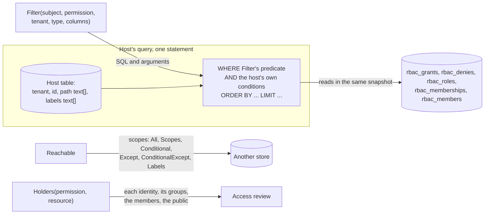

- **Filter** returns a condition for the host's own query, which reads the grants in the same
  statement as the rows, so sorting and pagination work and nothing changes between deciding and
  reading, for the query it was built for: build one for each. It never keeps a row Authorize would
  refuse. The subject's grants are matched through the path's GIN index, which merges the rows each
  finds, so its cost for each row grows with their number. Past a few on resources of the listed
  type, each row's own key is looked up in a hash of them, and past 128 on containers and the tenant,
  or past a few alongside those, each of its keys in one object of them all, so one with a grant on
  everything it created costs a row a few lookups; no index serves that, so the query reads every
  row of the tenant its other conditions keep. Denies are looked up so whatever their number: those
  on resources of the type by the row's own key, and those on containers and the tenant by each of
  its keys. Those naming the subject or its groups are read by those keys alone. Those naming the
  public or the tenant's members bind everyone, and any number of them can be on scopes of other
  types, which no index tells apart: while fewer than 16 denies are on scopes of the types a list
  reads, it reads those by type, and otherwise finds the ones naming everyone by those keys, so a
  tenant with many of both has every list read every deny naming everyone.
- **Reachable** returns the same as scopes, for a host that keeps its resources elsewhere.
  Conditional grants and conditional denies come back apart, to check one by one.
- **Holders** lists who may do a permission on a resource, for an access review. That is each
  identity, through its own grants and its groups', with the tenant's members and the public as
  one holder each. It marks holders that hold only under a condition, or that a deny, a
  constraint or a label may refuse.

## Labels and exclusive values

A label is mandatory access control above every grant. The host declares dimensions in
`Config.Labels`. A subject holds a dimension's values as permissions, `dimension:value`, which
roles granted on the tenant give, and a labeled resource is allowed only to a subject whose values
satisfy its label.

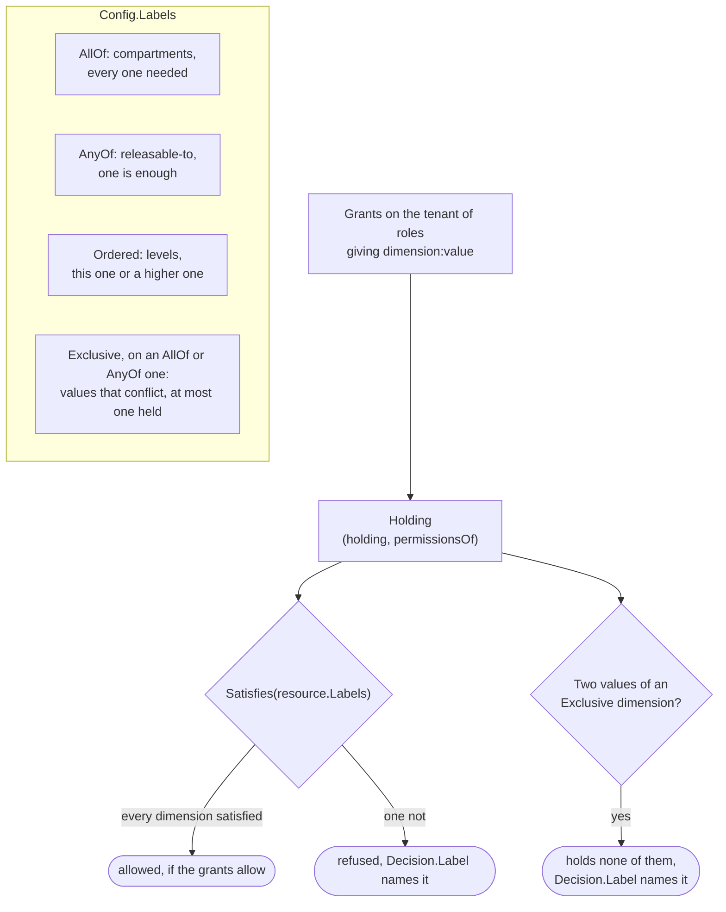

- **Values are decided on the bare tenant.** Every check decides a label value or a power to release
  on the tenant with no attributes or label, whatever tenant resource it is passed, as `Holding`
  reads them for a labeled check, which can't know what tenant the host means. So a check of a value
  and a check of a label agree, and an actor hands one on only as it holds it. A condition of theirs
  can't read the tenant's attributes: any read of them fails, a test of one's presence included, so
  a grant's gives nothing and a deny's denies, rather than hold or lift for what the bare tenant
  lacks. A constraint deciding them by the tenant's state reads it itself, through its `q`.
- **Releasing and writing.** `ReleasePermission(dimension)`, held on the tenant, is the power to
  release data to a looser label in that dimension, so only a holder of it can downgrade data. A
  `Holding`'s `MayWrite` and `MayRelease` say whether data read under one label may be written, or
  released, under another.
- **Exclusive values are checked when they change.** A change that would let anyone hold two
  values of an Exclusive dimension is refused, after its writes and under its locks. `Conflicts`
  lists anyone left able to, as a catalog change can leave them.

## Transactions and locks

Changes take PostgreSQL advisory locks, keyed by the schema holding the tables, as every session
reaching them names it whatever its search_path, so two changes to the same rows run
one after the other, each taking its locks in one order. The locks last until the transaction
ends, so under `WithTx` two host transactions changing the same scopes or principals in opposite
orders can still deadlock, as can a change that also writes rows it doesn't lock: PostgreSQL fails
one, which matches `ErrConflict`.

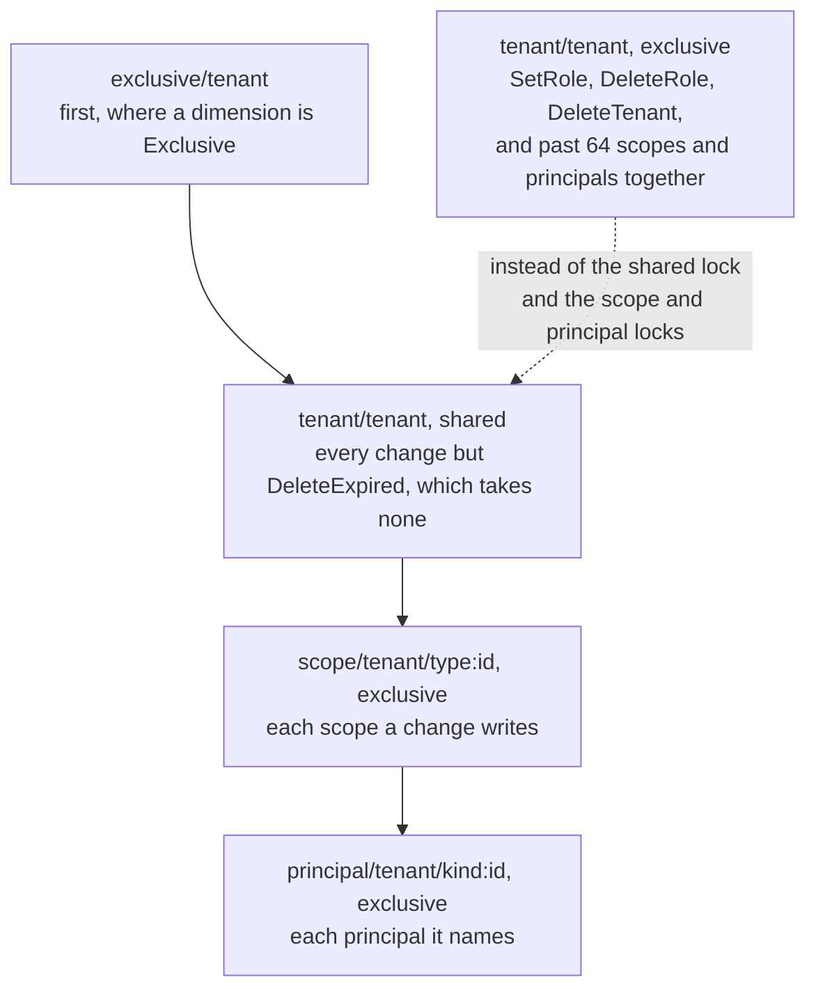

- **READ COMMITTED.** A change runs at READ COMMITTED, as its checks under the locks must read what
  committed before the locks were taken. Under `WithTx` the host's transaction must be at READ
  COMMITTED too, as must one `Migrate` is given.
- **Rows in one order.** `DeleteScopes` holds its scopes' locks and `DeletePrincipal` its
  principal's, so neither waits for the other, and both delete the principal's grants and
  eligibilities on those scopes: each locks them in the order of their scopes first, eligibilities
  before grants, so they don't deadlock. A revoke locks the grants it deletes in that order too, as
  a change ending places in groups ends activations among them without their scope's lock. Every
  change holds grants last, after its places and memberships, as `Activate` holds the places an
  activation rests on before its grant. `DeleteRole` removes a role's grants before its
  eligibilities, but holds the tenant's lock exclusive, so no change runs beside it but
  `DeleteExpired`, which waits on no row.
- **One snapshot for reads in several statements.** Explain, Reachable, Holders and Conflicts read
  in one REPEATABLE READ, READ ONLY transaction of their own on a pool, and AsOf in a REPEATABLE
  READ one it rolls back; the label values Explain, Reachable and Holders need are read after it.
  Under `WithTx` they read on the host's transaction at its isolation, AsOf in a savepoint.
- **Races** PostgreSQL refuses, such as a serialization failure or a deadlock between host
  transactions, match `ErrConflict`: try again.

## History, export and AsOf

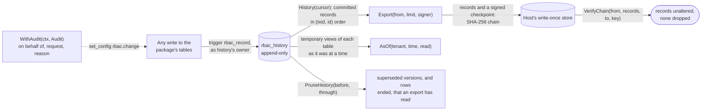

- **What a record holds.** Each holds the row as it was and as it became, when it took effect,
  the database role that wrote it, and the actor and call it was made through, with what the host
  attached. A write that bypassed the package is recorded too, with no actor. A row written
  before history was installed has one record from migrating, its baseline, dated when it was
  created, or at the epoch where that was before year 1 or at its first instant.
- **History's order.** `History` reads records in transaction order, and only those of
  transactions older than every transaction still running, which have all ended. So a cursor
  never passes a record that commits later. It, `Export` and `PruneHistory` name history by its
  schema, as `AsOf` does, and their types by pg_catalog's, so a session's temporary table or type
  stands in for none of it. A schema the application's role made or can create in, first on its
  search_path, would: that role can do neither.
- **Generations.** A cursor names its generation: the database cluster, by its system and
  timeline, and the database and schema. Failing over or recovering to a point in time starts a
  new generation, which an export starts again from `Genesis`. A restore that starts none, as
  from a disk snapshot, keeps the generation: where it lost a cursor's last record, `History`
  refuses that cursor, and history is exported again from the start.
- **The export chain.** `Export` hashes each record onto the last checkpoint with SHA-256 and signs
  the checkpoint with the host's `crypto.Signer`: ECDSA on P-256, P-384 or P-521, Ed25519, or RSA
  of at least 3072 bits, each verified with the Go standard library. `VerifyChain` checks a run of
  records between two checkpoints.
- **AsOf** stands temporary views of history in for the tables, in a transaction it rolls back,
  so every check, list and search answers as it would have at a past time, with the catalog and
  the label dimensions as they are now. Each statement reads history by the rows it names, through
  history's indexes.
- **PruneHistory** deletes only what an export has read and later versions supersede. It keeps
  each row's last version at or before its time, so AsOf answers as before for any later time,
  and refuses an earlier one; of a row whose last version by then ended it, it deletes every
  version, the end last. A prune that deleted records is recorded in history, and AsOf finds the
  latest prune's time by history's index.

## Database roles

The application's database role must not be able to rewrite history, so the schema is set up with
three roles. The README's [History](../README.md#history) section has the exact grants.

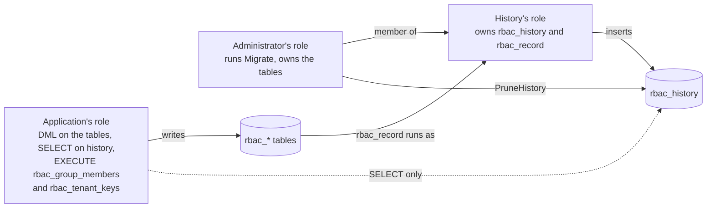

## Bounds

Every input that could grow without limit is bounded, so no call's cost depends on what a tenant
chose to store beyond these, but for the lists, which read what they list: `Filter` reads the
subject's grants on the scopes that can reach the listed type and the denies on them, and costs each
row a few lookups among them however many there are. The tables hold rows only within the same
bounds, so a role that writes around the package can store no row larger than the package writes.

| Bound | Value | What it limits |
|---|---|---|
| `MaxID` | 512 bytes | A tenant's, scope's or principal's id. |
| `MaxBindings` | 1,000 | Bindings in one `Apply`, and the grants, memberships, groups or members one `Import`, `DeleteGrants`, `SetMemberships`, `ImportGroups`, `DeleteGroups`, `ImportMembers`, `ChangeMembers` or `DeleteMembers` takes. |
| `MaxGrantsPerRole` | 20 | Grants in force of one role to one principal on one scope, differing by source, expiry or condition. Those from each source the host owns count apart. |
| `MaxDenies`, `MaxDenyEntries` | 100, 256 | Denies on a scope, and the principals, exemptions or permissions one names. |
| `MaxCustomRoles`, `MaxRoleEntries`, `MaxGrantableRoles` | 300, 1,000, 64 | Custom roles in a tenant, the permissions one gives and the types it is for, and roles one lists in `GrantableRoles`. |
| `MaxApprovers`, `MaxActivation` | 16, 366 days | An eligibility's approvers, and its longest activation. |
| `MaxGroupDepth` | 8 | How deeply groups nest. |
| `MaxPlacesInGroup` | 20 | Places in force of one principal in one group, each from another source. Those from each source the host owns count apart. |
| `MaxExpression` | 2,048 bytes | A condition's or requirement's expression. Its cost is bounded too. |
| What a check reads together | 80,000 units: hundreds of comparisons with literals, or three of the longest conditions that read a list or loop | The distinct conditions of an identity's conditional grants on a scope; of a scope's conditional grants to groups, the tenant's members and the public; each the tenant's and those from each source the host owns apart; of a scope's conditional denies; and the requirements of groups' eligibilities for a role on a scope. Each counts compiling it, 8 a byte, and the most evaluating it can cost, at most 10,000. On the tenant, one reading the action counts once for each label value it gives or denies. A check may spend this for each on each scope of its path. |
| `MaxConditionBytes` | 32 KiB | The conditions one `Apply` or `Import` carries, each distinct one counted once. |
| `MaxName`, `MaxDescription`, `MaxNote` | 128, 2,048, 2,048 characters | Names, titles and group ids, descriptions, and notes and justifications. |
| `MaxRequest` | 256 characters | A request id in `Audit`. |
| `MaxHistory`, `MaxPrune` | 10,000 each | Records read by one `History` call, and deleted by one prune. |
